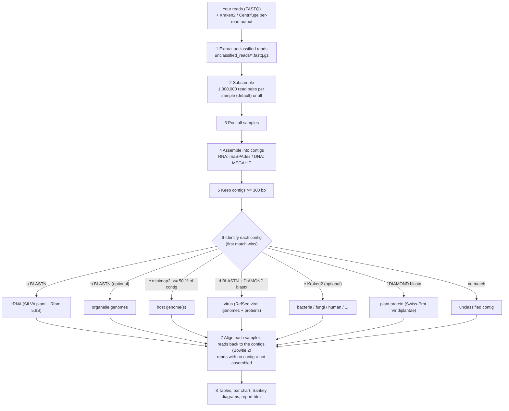

# unclassified-meta

**What is in the reads that Kraken2 or Centrifuge could not classify?**

Read classifiers such as Kraken2, Centrifuge and Centrifuger compare each short read with a reference
database. Reads from organisms that are missing from the database, or too different from it, come back
*unclassified*. In plant RNA-seq and metagenome data this "unknown" share can be most of the data.

`unclassified-meta` takes those unclassified reads and explains them:

1. it **extracts** the unclassified reads of every sample (and saves them as FASTQ files),
2. **joins** overlapping reads of all samples into longer sequences (*contigs*, de novo assembly),
3. **identifies** each contig against host genomes, rRNA, virus genomes and proteins, and plant proteins,
   in a fixed order (first match wins),
4. **counts** how many reads of each sample belong to each identity, by aligning the reads back to the contigs,
5. writes **tables**, **bar charts**, **Sankey diagrams** and one **HTML report**.

It works for **RNA-seq** (`--mode rna`, assembler rnaSPAdes) and **DNA shotgun** data (`--mode dna`,
assembler MEGAHIT), paired-end or single-end.

The method was first used on cactus (*Opuntia cochenillifera*) diel RNA-seq data, where 88-95 % of the
reads without a genome alignment turned out to be plant viruses (potexviruses and Cactus carlavirus 1).

---

## Contents

1. [How it works (diagram)](#1-how-it-works)
2. [Install (step by step, from micromamba)](#2-install-step-by-step)
3. [Download the references](#3-references-required)
4. [Prepare your input](#4-prepare-your-input)
5. [Run](#5-run)
6. [All options, with examples](#6-all-options)
7. [Worked example](#7-worked-example)
8. [Output files, one by one](#8-output-files)
9. [Memory, time and disk](#9-memory-time-and-disk)
10. [Troubleshooting / FAQ](#10-troubleshooting--faq)
11. [Tools and citations](#11-tools-and-citations)

---

## 1. How it works



**In plain words.** Think of each sample as a box of jigsaw pieces (reads). The classifier already placed
the pieces that match its picture book (database). The leftover pieces are joined into larger patches
(contigs), because a large patch is much easier to recognise than a single piece. Each patch is then
compared, in a fixed order, with known pictures: the host genome, ribosomal RNA, viruses, other
organisms and plant proteins. Finally every leftover piece is traced back to the patch it belongs to, so
we can say what share of each sample's unknown reads is virus, host, bacteria and so on.

**Why a fixed order?** A contig gets the label of the first check it passes. The host genome is checked
before the viruses, so a host gene is never counted as a virus.

**Which steps use BLAST and DIAMOND?** BLAST+ and DIAMOND are installed by the environment
(`environment.yml`):

| Step | Program | Against |
|---|---|---|
| rRNA | **BLASTN** (`-task dc-megablast`) | plant rRNA (SILVA + Rfam 5.8S) |
| organelle (optional) | **BLASTN** (`dc-megablast`) | your plastid / mitochondrial genomes |
| host | **minimap2** (`-x asm20`) | your host genome(s) |
| virus | **BLASTN** (`dc-megablast`, >= 100 bp, E <= 1e-10) **and DIAMOND blastx** (E <= 1e-10) | RefSeq viral genomes; RefSeq viral proteins |
| virus, custom (optional) | **BLASTN**, plus **TBLASTX** with `--tblastx` | your small virus FASTA (`--extra-virus-fasta`) |
| other organisms (optional) | **Kraken2** | a Kraken2 database |
| plant protein | **DIAMOND blastx** (`--sensitive`, E <= 1e-10) | Swiss-Prot Viridiplantae (+ your host proteome) |

TBLASTX is not run against all RefSeq viral genomes because it is far too slow for thousands of contigs;
DIAMOND blastx against the viral proteins finds the divergent viruses instead.

---

## 2. Install, step by step

You need a Linux computer (or a cluster login) with internet access, about 10 GB of free disk for the
software and references, and 16 GB of memory or more.

**Step 1 — install micromamba** (skip if `micromamba --version` already works):

```bash
"${SHELL}" <(curl -L micro.mamba.pm/install.sh)
# open a new terminal afterwards, then check:
micromamba --version
```

**Step 2 — get the code:**

```bash
git clone https://github.com/wyim-pgl/unclassified_meta.git
cd unclassified_meta
```

**Step 3 — create the environment** (all programs: SPAdes, MEGAHIT, BLAST+, DIAMOND, minimap2, Bowtie 2,
samtools, seqtk, seqkit, Kraken2, Python libraries). This takes 5-20 minutes:

```bash
micromamba create -y -f environment.yml
micromamba activate unclassified_meta
```

**Step 4 — install the `unclassified-meta` command into that environment:**

```bash
pip install -e .
unclassified-meta --version
```

**Step 5 — check that everything works** (about 2-5 minutes, no downloads):

```bash
pytest -q
```

On a cluster, activate the environment inside your job script, for example
`eval "$(micromamba shell hook --shell bash)"; micromamba activate unclassified_meta`, or put the
environment's `bin/` first in `PATH`.

> **Old clusters (glibc 2.17, e.g. CentOS 7).** The pinned versions in `environment.yml` were chosen to
> run there; if `micromamba create` cannot solve on your system, remove the version pins of the
> failing packages and try again.

---

## 3. References (required)

Three reference sets are **required**. One command downloads and indexes all of them:

```bash
unclassified-meta download-refs --outdir refs --threads 8
```

It writes this layout (you then pass `--refs refs` to `run`):

```
refs/
  viral/refseq_viral.fna            RefSeq viral genomes  (+ BLAST index files refseq_viral.fna.n*)
  viral/refseq_viral_protein.dmnd   RefSeq viral proteins, DIAMOND database
  rrna/plant_rrna.fasta             plant rRNA            (+ BLAST index files)
  protein/sprot_viridiplantae.dmnd  Swiss-Prot plant proteins, DIAMOND database
  REFS_VERSION.tsv                  what was downloaded, from where, when, sizes, sequence counts
```

Plus your **host genome** (FASTA), also required: give it with `--host NAME=genome.fa`.

### Download links (all checked on 2026-11-17)

| Reference | URL | File(s) | Download (compressed) | On disk after preparation | Used by |
|---|---|---|---|---|---|
| RefSeq viral genomes | https://ftp.ncbi.nlm.nih.gov/refseq/release/viral/ | `viral.*.1.genomic.fna.gz` (currently `viral.1.1.genomic.fna.gz`) | 178 MB | {{SIZE_VIRAL_GENOMIC}} | virus layer, BLASTN |
| RefSeq viral proteins | same folder | `viral.*.protein.faa.gz` (currently `viral.1.protein.faa.gz`) | 107 MB | {{SIZE_VIRAL_PROTEIN}} | virus layer, DIAMOND blastx |
| SILVA 138.2 SSU | https://www.arb-silva.de/fileadmin/silva_databases/release_138.2/Exports/ | `SILVA_138.2_SSURef_NR99_tax_silva.fasta.gz` | 201 MB | rRNA total {{SIZE_RRNA}} | rRNA layer, BLASTN |
| SILVA 138.2 LSU | same folder | `SILVA_138.2_LSURef_NR99_tax_silva.fasta.gz` | 71 MB | (in rRNA total) | rRNA layer, BLASTN |
| Rfam 5.8S rRNA | https://ftp.ebi.ac.uk/pub/databases/Rfam/CURRENT/fasta_files/RF00002.fa.gz | `RF00002.fa.gz` | 0.8 MB | (in rRNA total) | rRNA layer, BLASTN |
| Swiss-Prot Viridiplantae | https://rest.uniprot.org/uniprotkb/stream?format=fasta&compressed=true&query=%28reviewed%3Atrue%29%20AND%20%28taxonomy_id%3A33090%29 | streamed FASTA (42,110 proteins on 2026-11-17) | {{SIZE_SPROT_DL}} | {{SIZE_SPROT}} | protein layer, DIAMOND blastx |
| *optional* Kraken2 database | https://benlangmead.github.io/aws-indexes/k2 | e.g. Viral 0.5 GB archive / 0.6 GB index; Standard-8 5.5 / 7.5 GB; PlusPF 89.7 / 116.1 GB; Standard 84.6 / 109.4 GB (release 10/22/2026) | see left | see left | kraken2 layer |

**Total disk for the required references: {{SIZE_TOTAL}}** (measured with `du -sh refs/` on
{{SIZE_DATE}}, RefSeq release 238). RefSeq viral grows with every release, so expect these numbers to
increase slowly. Downloaded `.gz` files are deleted after preparation unless you add `--keep-sources`.
`download-refs` prints the expected download and disk size first and warns when the folder does not have
enough free space. Typical download time: 5-20 minutes, depending on the network.

The rRNA set keeps only SILVA records whose taxonomy contains `;Chloroplastida;` (green-plant nuclear
18S/28S), `;Chloroplast;` (plastid 16S/23S) or `;Mitochondria;` (mitochondrial rRNA), plus all Rfam 5.8S
sequences, with U converted to T. Bacterial, fungal and animal rRNA is deliberately *not* included, so
those contigs stay available for the virus, Kraken2 and protein checks.

### Manual download (if you prefer, or if the machine running the pipeline has no internet)

```bash
mkdir -p refs/viral refs/rrna refs/protein && cd refs
# RefSeq viral (list the folder first; the number of viral.N files can grow)
curl -s https://ftp.ncbi.nlm.nih.gov/refseq/release/viral/ | grep -o 'viral\.[0-9]*\.1\.genomic\.fna\.gz\|viral\.[0-9]*\.protein\.faa\.gz' | sort -u
wget https://ftp.ncbi.nlm.nih.gov/refseq/release/viral/viral.1.1.genomic.fna.gz
wget https://ftp.ncbi.nlm.nih.gov/refseq/release/viral/viral.1.protein.faa.gz
zcat viral.*.1.genomic.fna.gz > viral/refseq_viral.fna
zcat viral.*.protein.faa.gz > viral/refseq_viral_protein.faa
makeblastdb -in viral/refseq_viral.fna -dbtype nucl -out viral/refseq_viral.fna
diamond makedb --in viral/refseq_viral_protein.faa -d viral/refseq_viral_protein
# SILVA 138.2 + Rfam 5.8S (on a cluster: download on the LOGIN node; compute nodes may not reach arb-silva.de)
wget https://www.arb-silva.de/fileadmin/silva_databases/release_138.2/Exports/SILVA_138.2_SSURef_NR99_tax_silva.fasta.gz
wget https://www.arb-silva.de/fileadmin/silva_databases/release_138.2/Exports/SILVA_138.2_LSURef_NR99_tax_silva.fasta.gz
wget https://ftp.ebi.ac.uk/pub/databases/Rfam/CURRENT/fasta_files/RF00002.fa.gz
# ... filtering is easiest with the tool itself, which reuses the files already present:
#     unclassified-meta download-refs --outdir refs --only rrna --keep-sources
# Swiss-Prot Viridiplantae
wget -O sprot_viridiplantae.faa.gz 'https://rest.uniprot.org/uniprotkb/stream?format=fasta&compressed=true&query=%28reviewed%3Atrue%29%20AND%20%28taxonomy_id%3A33090%29'
zcat sprot_viridiplantae.faa.gz > protein/sprot_viridiplantae.faa
diamond makedb --in protein/sprot_viridiplantae.faa -d protein/sprot_viridiplantae
```

Equivalent single command: `unclassified-meta download-refs --outdir refs`. To see what would be
downloaded without downloading: `unclassified-meta download-refs --outdir refs --dry-run`.

### Reusing references you already have

* An existing plant rRNA FASTA (for example the SortMeRNA plant rRNA set):
  `unclassified-meta download-refs --outdir refs --rrna-fasta /path/plant_rrna.fasta`
* Any file can be given directly to `run` instead of `--refs`: `--rrna`, `--virus`, `--virus-protein`,
  `--protein` (FASTA or a DIAMOND `.dmnd`). BLAST indexes are built automatically when missing.
* Download only some sets: `--only viral rrna protein` (any subset).

---

## 4. Prepare your input

You need, for each sample:

* the reads: paired-end `R1` + `R2` FASTQ (gzipped or not), or one single-end FASTQ, **and**
* optionally the classifier's **per-read output** (not the summary report):
  * Kraken2: the file written by `kraken2 --output FILE` (lines start with `C` or `U`),
  * Centrifuge or Centrifuger: the file written by `-S FILE` (columns `readID seqID taxID score ...`).

If you have no classifier output, give reads that are already unclassified (for example Kraken2
`--unclassified-out` files, or reads that did not map to the host); every read is then treated as unclassified.

### Option A — a folder (simplest, no sample sheet)

Put everything in one folder with matching names:

```
reads/
  leaf1_R1.fastq.gz   leaf1_R2.fastq.gz   leaf1.kraken2        # paired + Kraken2 output
  leaf2_1.fq.gz       leaf2_2.fq.gz       leaf2.centrifuge     # paired + Centrifuge output
  root1.fastq.gz                          root1.cfr            # single-end + Centrifuger output
  soil1_R1.fastq.gz   soil1_R2.fastq.gz                        # no classifier output: all reads used
```

Recognised read names: `NAME_R1/_R2`, `NAME_1/_2`, `NAME.R1/.R2`, `NAME_R1_001` (Illumina), with
`.fastq`, `.fq`, `.fastq.gz` or `.fq.gz`. Recognised classifier outputs: `NAME.kraken`, `NAME.kraken2`,
`NAME.kraken.out`, `NAME.kraken2.out`, `NAME.k2` (Kraken2); `NAME.centrifuge`, `NAME.centrifuge.out`
(Centrifuge); `NAME.cfr`, `NAME.centrifuger`, `NAME.centrifuger.out` (Centrifuger). Kraken/Centrifuge
*report* files (percentage summaries) are recognised and ignored.

Check what was detected before running:

```bash
unclassified-meta detect --input-dir reads -o results
# prints one line per sample and writes results/samplesheet.detected.tsv
```

### Option B — a sample sheet

A tab-separated file with a header. `r2`, `classifier_output` and `classifier` may be `.` or empty.
Relative paths are relative to the sheet's folder.

```
sample	r1	r2	classifier_output	classifier
leaf1	reads/leaf1_R1.fastq.gz	reads/leaf1_R2.fastq.gz	reads/leaf1.kraken2	kraken2
leaf2	reads/leaf2_1.fq.gz	reads/leaf2_2.fq.gz	reads/leaf2.centrifuge	centrifuge
root1	reads/root1.fastq.gz	.	reads/root1.cfr	centrifuger
soil1	reads/soil1_R1.fastq.gz	reads/soil1_R2.fastq.gz	.	none
```

Sample names may contain letters, digits, `.`, `_` and `-`.

---

## 5. Run

```bash
micromamba activate unclassified_meta

# RNA-seq, references from download-refs, one host genome
unclassified-meta run --input-dir reads --refs refs --host cactus=genome.fa \
    --mode rna --threads 16 --memory 64 -o results

# Only extract the unclassified reads (no assembly)
unclassified-meta extract --input-dir reads -o results
```

A run that stops (time limit, power cut) can simply be started again with the same command: finished
steps are skipped (markers in `results/work/.done/`). To start a step again, delete its marker.

**Slurm example**

```bash
#!/bin/bash
#SBATCH --cpus-per-task=16
#SBATCH --mem=64G
#SBATCH --time=2-00:00:00
eval "$(micromamba shell hook --shell bash)"
micromamba activate unclassified_meta
unclassified-meta run --samples samples.tsv --refs /path/refs --host cactus=/path/genome.fa \
    --mode rna -t 16 --memory 60 -o results
```

---

## 6. All options

`unclassified-meta run` (everything can also be set in a YAML file with `-c config.yaml`; the command
line wins; `unclassified-meta config` prints all settings with their defaults).

| Option | Default | What it does | Example |
|---|---|---|---|
| `--input-dir DIR` | – | detect samples from file names (section 4A) | `--input-dir reads` |
| `--samples TSV` | – | use a sample sheet (section 4B); give this *or* `--input-dir` | `--samples samples.tsv` |
| `-o, --outdir DIR` | `results` | output folder | `-o results_run1` |
| `--mode rna\|dna` | `rna` | RNA-seq (rnaSPAdes) or DNA shotgun (MEGAHIT) | `--mode dna` |
| `--refs DIR` | – | folder made by `download-refs`; fills the four required references | `--refs refs` |
| `--host NAME=FASTA` | **required** | host genome; repeat for more hosts, checked in the given order | `--host cactus=Ococ.fa --host relative=Obas.fa` |
| `--rrna FASTA` | from `--refs` | plant rRNA FASTA | `--rrna my_rrna.fa` |
| `--virus FASTA` | from `--refs` | virus genome FASTA (BLASTN) | `--virus refseq_viral.fna` |
| `--virus-protein DMND\|FASTA` | from `--refs` | virus proteins (DIAMOND blastx) | `--virus-protein viral.dmnd` |
| `--protein DMND\|FASTA` | from `--refs` | plant proteins (DIAMOND blastx) | `--protein sprot_plants.dmnd` |
| `--host-proteome FASTA` | none | your host's proteins, added to the protein check | `--host-proteome Ococ.pep.fa` |
| `--organelle FASTA` | none | plastid / mitochondrial genomes (BLASTN) | `--organelle cp_mt.fa` |
| `--extra-virus-fasta FASTA` | none | a small virus set you trust (BLASTN; checked with RefSeq) | `--extra-virus-fasta cactus_viruses.fa` |
| `--tblastx` | off | also TBLASTX against `--extra-virus-fasta` (slow; keep that file small) | `--tblastx` |
| `--kraken2-db DIR` | none | classify contigs with Kraken2 too (bacteria, fungi, human ...) | `--kraken2-db k2_pluspf` |
| `--subsample N\|all` | `1000000` | reads (pairs) per sample used for assembly and counting | `--subsample 500000`, `--subsample all` |
| `--seed N` | `11` | random seed of the subsampling | `--seed 42` |
| `--memory GB` | `32` | memory for the assembler; also used for the memory warning | `--memory 120` |
| `-t, --threads N` | `8` | CPU threads | `-t 32` |
| `--assembler` | `auto` | `auto` (rna: rnaspades, dna: megahit), `rnaspades`, `megahit`, `metaspades` | `--assembler megahit` |
| `--min-contig-len N` | `300` | shortest contig kept | `--min-contig-len 500` |
| `--keep-work` | off | keep the pooled reads in `work/` | |

Thresholds (YAML only, `thresholds:` section): rRNA and organelle need >= 85 % identity over >= 50 % of
the contig; host needs >= 50 % of the contig aligned (`minimap2 -x asm20`); virus BLASTN needs an
alignment >= 100 bp with E <= 1e-10; DIAMOND hits need E <= 1e-10. The check order is set by `priority:`
(default `rrna, organelle, host, virus, kraken2, protein`).

Other commands:

| Command | What it does |
|---|---|
| `unclassified-meta extract --input-dir reads -o results` | only write the unclassified reads per sample |
| `unclassified-meta detect --input-dir reads` | show detected samples and write the sample sheet |
| `unclassified-meta download-refs --outdir refs [--dry-run] [--only ...] [--rrna-fasta F]` | references |
| `unclassified-meta config > my_config.yaml` | write all settings with defaults, to edit |

**Subsampling.** By default 1,000,000 read pairs per sample are used for assembly and counting, which
keeps memory and time modest and gives stable percentages (the percentages are then applied to all the
sample's unclassified reads in the bar chart panel B and the Sankey diagrams). Use `--subsample all` to
use every read, for example to recover rare organisms. The full set of unclassified reads is always saved
in `unclassified_reads/`, whatever the subsample.

---

## 7. Worked example

The test data set in `tests/` is a small artificial example: a random "host" genome, two "viruses", a
"bacterium", a plant gene and an rRNA, with three samples (S1 paired + Kraken2, S2 paired + Centrifuge,
S3 single-end without classifier output).

```bash
python tests/make_synthetic.py example
unclassified-meta run --input-dir example/reads --refs example/refs --host testhost=example/host.fa \
    --mode rna -t 4 --memory 8 --subsample all -o example_out
```

Result (`example_out/tables/read_category_by_sample.tsv`, % of unclassified reads):

{{EXAMPLE_TABLE}}

Open `example_out/report.html` in a browser. Virus A is found by BLASTN (its genome is in the reference);
virus B has no similar genome in the reference, only a similar protein, and is found by DIAMOND blastx.

---

## 8. Output files

```
results/
  report.html                         one-page summary: tables, bar chart, links to the Sankey pages
  samplesheet.used.tsv                the samples as the pipeline understood them
  unclassified_reads/                 the unclassified reads of every sample (all reads, not subsampled)
     S1_R1.fastq.gz, S1_R2.fastq.gz   paired samples
     S3.fastq.gz                      single-end samples
  tables/
     input_summary.tsv
     read_category_by_sample.tsv
     reference_by_sample.tsv
     contig_category.tsv
     contig_names.tsv
     resources.tsv
  figures/
     read_categories.png / .pdf
     sankey_all_samples.html
     sankey/<sample>.html
  contigs/contigs.fa                  the assembled contigs >= min length (names contig_000001 ...)
  logs/pipeline.log                   every command that was run, with times
  work/                               intermediate files (BLAST/DIAMOND results, read-back counts, assembly)
```

**`tables/input_summary.tsv`** — one row per sample: `total_reads` (reads, or read pairs, in the
classifier output), `classified_reads` (assigned by the classifier), `unclassified_reads`, `reads_used`
(after subsampling), `paired`, `classifier`.

**`tables/read_category_by_sample.tsv`** — the main result. For each category (`host:NAME`, `virus`,
`rRNA`, `organelle`, `bacteria`/`fungi`/`human`/... from Kraken2, `protein` = plant protein match,
`unclassified` = contig without any match, `not_assembled` = read that is not part of any contig):
`n_<category>` reads counted, `frac_<category>` fraction of the reads used (all fractions of a sample add
up to 1), `est_<category>` the fraction applied to all unclassified reads of the sample.

**`tables/reference_by_sample.tsv`** — which reference each contig matched best (`best_hit`,
`best_hit_title`, e.g. the virus name), with `n_contigs`, `reads_pooled`, `pct_of_reads_used_pooled`,
`read_weighted_identity` (average % identity of the matching contigs, weighted by reads) and `pct_<sample>`
for every sample. Low identity (for example 70-85 % for a virus) means a related but different strain or
species.

**`tables/contig_category.tsv`** — one row per contig: `length`, `category`, `layer` (which check
assigned it), `method` (blastn, diamond_blastx, minimap2, kraken2 ...), `best_hit`, `best_hit_title`,
`identity`, `cover` (fraction of the contig aligned).

**`tables/contig_names.tsv`** — new contig name, the assembler's original name, length.

**`tables/resources.tsv`** — the assembler's peak memory (`max_rss_gb`), run time (`wall`), the
estimate made beforehand (`estimated_gb`) and the number of contigs kept.

**`figures/read_categories.png/.pdf`** — panel A: stacked bar per sample, % of unclassified reads in each
category; panel B (when classifier outputs were given): % of *all* reads, including those the classifier
had assigned.

**`figures/sankey_all_samples.html`, `figures/sankey/<sample>.html`** — interactive flow diagrams
(open in a browser; needs internet to load the plotting library): all reads → classified / unclassified
→ categories → the most common virus references.

---

## 9. Memory, time and disk

The assembler is the step that needs the most memory. Before assembling, the pipeline estimates the peak
memory from the number of pooled reads and prints a **WARNING** when the estimate exceeds `--memory` or
the free memory of the machine, with the subsample size that would fit.

{{MEMORY_SECTION}}

Disk: the unclassified reads (about the size of the input FASTQ times the unclassified fraction), the
references (section 3), and `work/` (roughly 2-3 times the pooled reads during assembly; the pooled reads
are deleted at the end unless `--keep-work`).

---

## 10. Troubleshooting / FAQ

**`ERROR: missing references ... Run unclassified-meta download-refs first`** — give `--refs refs` (the
folder made by `download-refs`) or the individual files, and a host genome with `--host`.

**`required tool(s) not on PATH`** — the environment is not active: `micromamba activate unclassified_meta`.

**`not Kraken2 per-read output ... pass the --output file, not the --report file`** — you gave the
summary report. Re-run Kraken2 with `--output sample.kraken2` (you can add `--report` as well).

**`classifier lists N unclassified reads but M were found`** (warning) — read names in the FASTQ differ
from those in the classifier output, or the classifier was run on different (e.g. trimmed) files. Use the
same FASTQ files that went into the classifier.

**`S: X mate-1 vs Y mate-2 unclassified reads`** — R1 and R2 files are not in the same read order.

**The assembler was killed / `std::bad_alloc` / out of memory** — lower `--subsample`, or request more
memory and raise `--memory`. MEGAHIT needs much less memory than rnaSPAdes; `--assembler megahit` also
works for RNA-seq.

**No samples detected with `--input-dir`** — check the file names (section 4A) and run
`unclassified-meta detect --input-dir DIR`.

**Can I use it without Kraken2/Centrifuge output?** Yes: give reads that are already unclassified (or
host-unmapped). The classifier columns in the tables are then 0.

**Can I add my own virus sequences?** Yes: `--extra-virus-fasta my_viruses.fa` (and `--tblastx` for
distant matches, if the file is small).

**Why are percentages computed on 1 million reads?** Assembly memory grows with the number of reads. One
million pairs per sample are enough for stable percentages of the major groups; the full unclassified
read set is still saved. Use `--subsample all` when you need rare groups.

**How do I rerun only the tables and figures?** Delete nothing; run the same command again — finished
steps are skipped and the tables, figures and report are rewritten.

**Downloads fail on a compute node.** Some clusters block outgoing connections on compute nodes. Run
`download-refs` on the login node (SILVA in particular), then point `--refs` at that folder.

---

## 11. Tools and citations

Please cite the tools the pipeline runs:

* rnaSPAdes / SPAdes — Bushmanova E. et al. (2019) GigaScience 8: giz100. doi:10.1093/gigascience/giz100
* MEGAHIT — Li D. et al. (2015) Bioinformatics 31: 1674-1676. doi:10.1093/bioinformatics/btv033
* BLAST+ — Camacho C. et al. (2009) BMC Bioinformatics 10: 421. doi:10.1186/1471-2105-10-421
* DIAMOND — Buchfink B., Reuter K., Drost H.-G. (2021) Nature Methods 18: 366-368. doi:10.1038/s41592-021-01101-x
* minimap2 — Li H. (2018) Bioinformatics 34: 3094-3100. doi:10.1093/bioinformatics/bty191
* Bowtie 2 — Langmead B., Salzberg S.L. (2012) Nature Methods 9: 357-359. doi:10.1038/nmeth.1923
* SAMtools — Danecek P. et al. (2021) GigaScience 10: giab008. doi:10.1093/gigascience/giab008
* seqtk — https://github.com/lh3/seqtk
* Kraken2 — Wood D.E., Lu J., Langmead B. (2019) Genome Biology 20: 257. doi:10.1186/s13059-019-1891-0
* Centrifuge — Kim D. et al. (2016) Genome Research 26: 1721-1729. doi:10.1101/gr.210641.116
* SILVA — Quast C. et al. (2013) Nucleic Acids Research 41: D590-D596. doi:10.1093/nar/gks1219
* Rfam — Kalvari I. et al. (2021) Nucleic Acids Research 49: D192-D200. doi:10.1093/nar/gkaa1047
* RefSeq — O'Leary N.A. et al. (2016) Nucleic Acids Research 44: D733-D745. doi:10.1093/nar/gkv1189
* UniProt — The UniProt Consortium (2025) Nucleic Acids Research 53: D609-D617. doi:10.1093/nar/gkae1010
* Plotly, matplotlib, pandas.

License: MIT. Contact: Won Yim (wyim@unr.edu).
