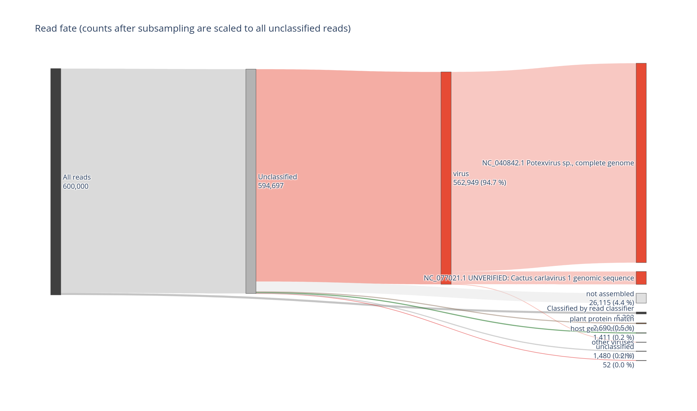
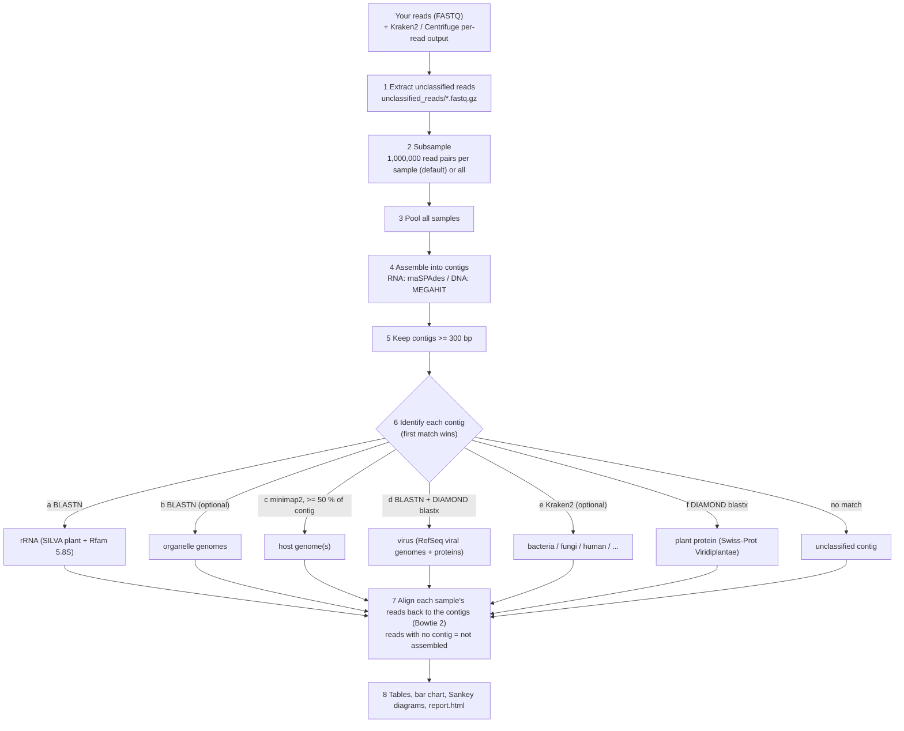
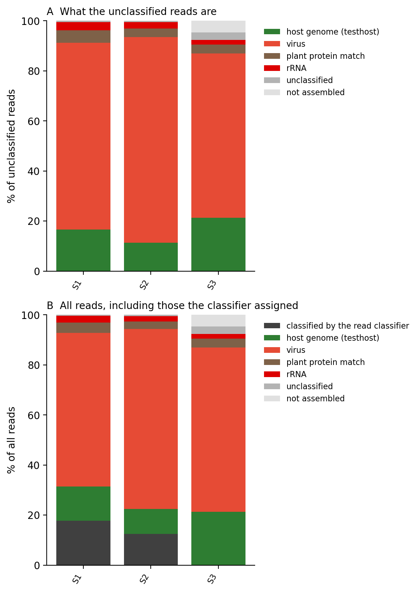
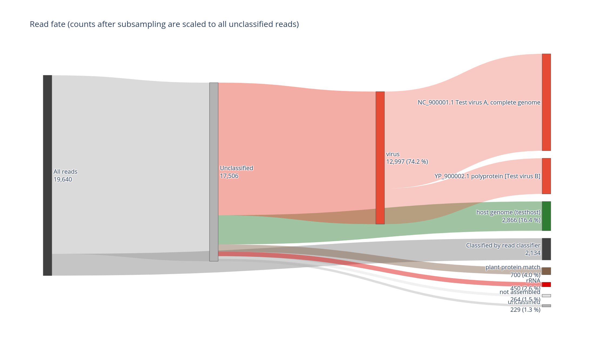
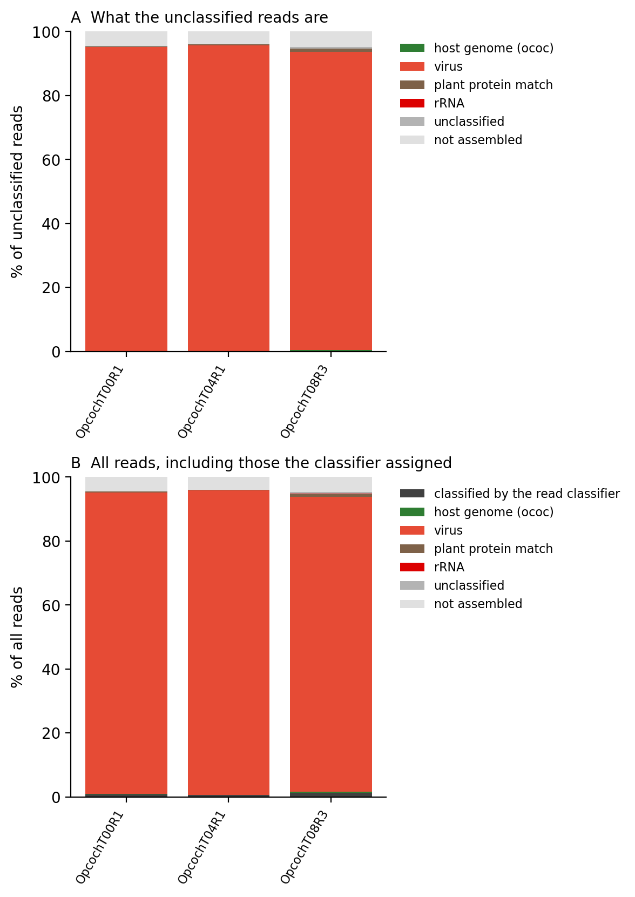
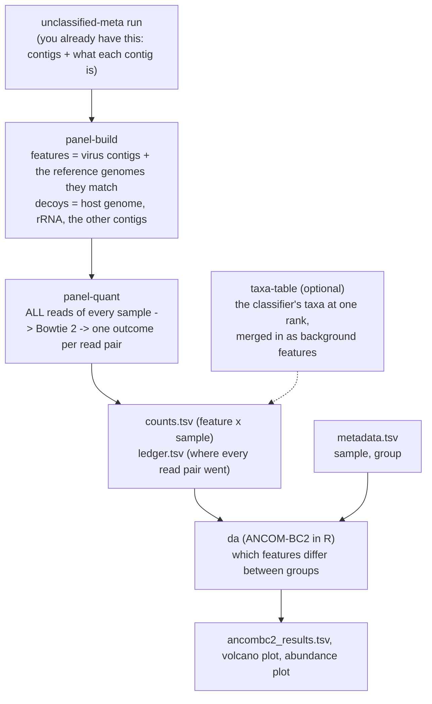

# unclassified-meta

**What is in the reads that Kraken2 or Centrifuge could not classify?**

Read classifiers such as Kraken2, Centrifuge and Centrifuger compare each short read with a reference
database. Reads from organisms that are missing from the database, or too different from it, come back
*unclassified*. In plant RNA-seq and metagenome data this "unknown" share can be most of the data.

`unclassified-meta` takes those unclassified reads and explains them:

1. it **extracts** the unclassified reads of every sample (and saves them as FASTQ files),
2. **joins** overlapping reads of all samples into longer sequences (*contigs*, de novo assembly),
3. **identifies** each contig against host genomes, rRNA, virus genomes and proteins, and plant proteins,
   in a fixed order (first match wins),
4. **counts** how many reads of each sample belong to each identity, by aligning the reads back to the contigs,
5. writes **tables**, **bar charts**, **Sankey diagrams** and one **HTML report**.

It works for **RNA-seq** (`--mode rna`, assembler rnaSPAdes) and **DNA shotgun** data (`--mode dna`,
assembler MEGAHIT), paired-end or single-end.

The method was first used on cactus (*Opuntia cochenillifera*) diel RNA-seq data, where 88-95 % of the
reads without a genome alignment turned out to be plant viruses (potexviruses and Cactus carlavirus 1).

**Example result** (cactus RNA-seq, 3 samples x 200,000 read pairs that did not align to the cactus genome;
Kraken2 Standard-8 classified only 0.5-1.3 % of them):



*Sankey diagram: all reads -> classified by Kraken2 or not -> what the pipeline found in the unclassified
reads -> which virus genome each viral contig is closest to. The width of each band is the number of reads.
The interactive version (`figures/sankey_all_samples.html`) shows the exact numbers when you hover over a band.*

---

## Contents

1. [How it works (diagram)](#1-how-it-works)
2. [Install (step by step, from micromamba)](#2-install-step-by-step)
3. [Download the references](#3-references-required)
4. [Prepare your input](#4-prepare-your-input)
5. [Run](#5-run)
6. [All options, with examples](#6-all-options)
7. [Worked example](#7-worked-example)
8. [Output files, one by one](#8-output-files)
9. [Memory, time and disk](#9-memory-time-and-disk)
10. [Differential abundance of viruses / selected taxa (panel workflow)](#10-differential-abundance-of-viruses--selected-taxa-panel-workflow)
    (with [repeated measures](#repeated-measures---rand-formula) and
    [the classifier's taxa in the same table](#adding-the-classifiers-taxa-taxa-table),
    [reads that fit several taxa](#reads-that-fit-several-taxa-em-and-multiple-imputation) and
    [one organism, one feature](#one-organism-one-feature-panel-taxonomy))
11. [Checking classifier thresholds with reversed control reads](#11-checking-classifier-thresholds-with-reversed-control-reads)
12. [Troubleshooting / FAQ](#12-troubleshooting--faq)
13. [Tools and citations](#13-tools-and-citations)
14. [Acknowledgements](#14-acknowledgements)

---

## 1. How it works



**In plain words.** Think of each sample as a box of jigsaw pieces (reads). The classifier already placed
the pieces that match its picture book (database). The leftover pieces are joined into larger patches
(contigs), because a large patch is much easier to recognise than a single piece. Each patch is then
compared, in a fixed order, with known pictures: the host genome, ribosomal RNA, viruses, other
organisms and plant proteins. Finally every leftover piece is traced back to the patch it belongs to, so
we can say what share of each sample's unknown reads is virus, host, bacteria and so on.

**Why a fixed order?** A contig gets the label of the first check it passes. The host genome is checked
before the viruses, so a host gene is never counted as a virus.

**Which steps use BLAST and DIAMOND?** BLAST+ and DIAMOND are installed by the environment
(`environment.yml`):

| Step | Program | Against |
|---|---|---|
| rRNA | **BLASTN** (`-task dc-megablast`) | plant rRNA (SILVA + Rfam 5.8S) |
| organelle (optional) | **BLASTN** (`dc-megablast`) | your plastid / mitochondrial genomes |
| host | **minimap2** (`-x asm20`) | your host genome(s) |
| virus | **BLASTN** (`dc-megablast`, >= 100 bp, E <= 1e-10) **and DIAMOND blastx** (E <= 1e-10) | RefSeq viral genomes; RefSeq viral proteins |
| virus, custom (optional) | **BLASTN**, plus **TBLASTX** with `--tblastx` | your small virus FASTA (`--extra-virus-fasta`) |
| other organisms (optional) | **Kraken2** | a Kraken2 database |
| plant protein | **DIAMOND blastx** (`--sensitive`, E <= 1e-10) | Swiss-Prot Viridiplantae (+ your host proteome) |

TBLASTX is not run against all RefSeq viral genomes because it is far too slow for thousands of contigs;
DIAMOND blastx against the viral proteins finds the divergent viruses instead.

---

## 2. Install, step by step

You need a Linux computer (or a cluster login) with internet access, about 10 GB of free disk for the
software and references, and 16 GB of memory or more.

**Step 1 — install micromamba** (skip if `micromamba --version` already works):

```bash
"${SHELL}" <(curl -L micro.mamba.pm/install.sh)
# open a new terminal afterwards, then check:
micromamba --version
```

**Step 2 — get the code:**

```bash
git clone https://github.com/wyim-pgl/unclassified_meta.git
cd unclassified_meta
```

**Step 3 — create the environment** (all programs: SPAdes, MEGAHIT, BLAST+, DIAMOND, minimap2, Bowtie 2,
samtools, seqtk, seqkit, Kraken2, Python libraries). This takes 5-20 minutes:

```bash
micromamba create -y -f environment.yml
micromamba activate unclassified_meta
```

**Step 4 — install the `unclassified-meta` command into that environment:**

```bash
pip install -e .
unclassified-meta --version
```

**Step 5 — check that everything works** (about 2-5 minutes, no downloads):

```bash
pytest -q
```

On a cluster, activate the environment inside your job script, for example
`eval "$(micromamba shell hook --shell bash)"; micromamba activate unclassified_meta`, or put the
environment's `bin/` first in `PATH`.

> **Old clusters (glibc 2.17, e.g. CentOS 7).** The pinned versions in `environment.yml` were chosen to
> run there; if `micromamba create` cannot solve on your system, remove the version pins of the
> failing packages and try again.

---

## 3. References (required)

Three reference sets are **required**. One command downloads and indexes all of them:

```bash
unclassified-meta download-refs --outdir refs --threads 8
```

It writes this layout (you then pass `--refs refs` to `run`):

```
refs/
  viral/refseq_viral.fna            RefSeq viral genomes  (+ BLAST index files refseq_viral.fna.n*)
  viral/refseq_viral_protein.dmnd   RefSeq viral proteins, DIAMOND database
  rrna/plant_rrna.fasta             plant rRNA            (+ BLAST index files)
  protein/sprot_viridiplantae.dmnd  Swiss-Prot plant proteins, DIAMOND database
  REFS_VERSION.tsv                  what was downloaded, from where, when, sizes, sequence counts
```

Plus your **host genome** (FASTA), also required: give it with `--host NAME=genome.fa`.

### Download links (all checked on 2026-11-17)

| Reference | URL | File(s) | Download (compressed) | On disk after preparation | Used by |
|---|---|---|---|---|---|
| RefSeq viral genomes | https://ftp.ncbi.nlm.nih.gov/refseq/release/viral/ | `viral.*.1.genomic.fna.gz` (currently `viral.1.1.genomic.fna.gz`) | 178 MB | 709 MB (FASTA 593 MB, 19,641 genomes + BLAST index) | virus layer, BLASTN |
| RefSeq viral proteins | same folder | `viral.*.protein.faa.gz` (currently `viral.1.protein.faa.gz`) | 107 MB | 447 MB (FASTA 229 MB, 722,823 proteins + DIAMOND db 239 MB) | virus layer, DIAMOND blastx |
| SILVA 138.2 SSU | https://www.arb-silva.de/fileadmin/silva_databases/release_138.2/Exports/ | `SILVA_138.2_SSURef_NR99_tax_silva.fasta.gz` | 201 MB | rRNA total 71 MB (FASTA 53 MB, 37,663 sequences + BLAST index) | rRNA layer, BLASTN |
| SILVA 138.2 LSU | same folder | `SILVA_138.2_LSURef_NR99_tax_silva.fasta.gz` | 71 MB | (in rRNA total) | rRNA layer, BLASTN |
| Rfam 5.8S rRNA | https://ftp.ebi.ac.uk/pub/databases/Rfam/CURRENT/fasta_files/RF00002.fa.gz | `RF00002.fa.gz` | 0.8 MB | (in rRNA total) | rRNA layer, BLASTN |
| Swiss-Prot Viridiplantae | https://rest.uniprot.org/uniprotkb/stream?format=fasta&compressed=true&query=%28reviewed%3Atrue%29%20AND%20%28taxonomy_id%3A33090%29 | streamed FASTA (42,110 proteins on 2026-11-17) | 10 MB | 41 MB (FASTA 21 MB + DIAMOND db 21 MB) | protein layer, DIAMOND blastx |
| *optional* Kraken2 database | https://benlangmead.github.io/aws-indexes/k2 | e.g. Viral 0.5 GB archive / 0.6 GB index; Standard-8 5.5 / 7.5 GB; PlusPF 89.7 / 116.1 GB; Standard 84.6 / 109.4 GB (release 10/22/2026) | see left | see left | kraken2 layer |

**Total disk for the required references: 1.3 GB after preparation; about 0.53 GB is downloaded, and about 1.8 GB is used at the peak while the downloaded `.gz` files still exist** (measured with `du -sh refs/` on
2026-11-17 on a Linux HPC login node; the full `download-refs` run took 2 min and 0.3 GB of memory there, RefSeq release 238). RefSeq viral grows with every release, so expect these numbers to
increase slowly. Downloaded `.gz` files are deleted after preparation unless you add `--keep-sources`.
`download-refs` prints the expected download and disk size first and warns when the folder does not have
enough free space. Typical download time: 5-20 minutes, depending on the network.

The rRNA set keeps only SILVA records whose taxonomy contains `;Chloroplastida;` (green-plant nuclear
18S/28S), `;Chloroplast;` (plastid 16S/23S) or `;Mitochondria;` (mitochondrial rRNA), plus all Rfam 5.8S
sequences, with U converted to T. Bacterial, fungal and animal rRNA is deliberately *not* included, so
those contigs stay available for the virus, Kraken2 and protein checks.

### Manual download (if you prefer, or if the machine running the pipeline has no internet)

```bash
mkdir -p refs/viral refs/rrna refs/protein && cd refs
# RefSeq viral (list the folder first; the number of viral.N files can grow)
curl -s https://ftp.ncbi.nlm.nih.gov/refseq/release/viral/ | grep -o 'viral\.[0-9]*\.1\.genomic\.fna\.gz\|viral\.[0-9]*\.protein\.faa\.gz' | sort -u
wget https://ftp.ncbi.nlm.nih.gov/refseq/release/viral/viral.1.1.genomic.fna.gz
wget https://ftp.ncbi.nlm.nih.gov/refseq/release/viral/viral.1.protein.faa.gz
zcat viral.*.1.genomic.fna.gz > viral/refseq_viral.fna
zcat viral.*.protein.faa.gz > viral/refseq_viral_protein.faa
makeblastdb -in viral/refseq_viral.fna -dbtype nucl -out viral/refseq_viral.fna
diamond makedb --in viral/refseq_viral_protein.faa -d viral/refseq_viral_protein
# SILVA 138.2 + Rfam 5.8S (on a cluster: download on the LOGIN node; compute nodes may not reach arb-silva.de)
wget https://www.arb-silva.de/fileadmin/silva_databases/release_138.2/Exports/SILVA_138.2_SSURef_NR99_tax_silva.fasta.gz
wget https://www.arb-silva.de/fileadmin/silva_databases/release_138.2/Exports/SILVA_138.2_LSURef_NR99_tax_silva.fasta.gz
wget https://ftp.ebi.ac.uk/pub/databases/Rfam/CURRENT/fasta_files/RF00002.fa.gz
# ... filtering is easiest with the tool itself, which reuses the files already present:
#     unclassified-meta download-refs --outdir refs --only rrna --keep-sources
# Swiss-Prot Viridiplantae
wget -O sprot_viridiplantae.faa.gz 'https://rest.uniprot.org/uniprotkb/stream?format=fasta&compressed=true&query=%28reviewed%3Atrue%29%20AND%20%28taxonomy_id%3A33090%29'
zcat sprot_viridiplantae.faa.gz > protein/sprot_viridiplantae.faa
diamond makedb --in protein/sprot_viridiplantae.faa -d protein/sprot_viridiplantae
```

A folder prepared by hand like this (or copied from another machine) has no manifest yet, and `run` refuses
reference folders without one. Adopt it once; this checks that every expected FASTA holds sequences, builds
missing BLAST / DIAMOND databases, writes `MANIFEST.json` in `viral/`, `rrna/` and `protein/`, and records the
versions you give (the others are written as `unknown`):

```bash
# use the release numbers of the files you downloaded (RefSeq: the RELEASE_NUMBER file of the release folder)
unclassified-meta seal-refs refs --version refseq_viral_genomic=RELEASE --version refseq_viral_protein=RELEASE \
    --version plant_rrna=SILVA_138.2
```

Expected layout: `viral/refseq_viral.fna` plus `viral/refseq_viral_protein.dmnd` (or the `.faa` to build it
from), `rrna/plant_rrna.fasta`, and `protein/sprot_viridiplantae.dmnd` (or `.faa`). Run `seal-refs` again after
replacing any file in the folder.

Equivalent single command: `unclassified-meta download-refs --outdir refs`. To see what would be
downloaded without downloading: `unclassified-meta download-refs --outdir refs --dry-run`.
Downloaded parts are cached in `*/src/` (with `--keep-sources`) together with a small record of the URL and
release they came from; a part from another release (or, for sources without a release number, from another
day) is fetched again, and SILVA files are checked against the MD5 that SILVA publishes next to them.

### Reusing references you already have

* An existing plant rRNA FASTA (for example the SortMeRNA plant rRNA set):
  `unclassified-meta download-refs --outdir refs --rrna-fasta /path/plant_rrna.fasta`
* Any file can be given directly to `run` instead of `--refs`: `--rrna`, `--virus`, `--virus-protein`,
  `--protein` (FASTA or a DIAMOND `.dmnd`). BLAST indexes are built automatically when missing.
* Download only some sets: `--only viral rrna protein` (any subset).

---

## 4. Prepare your input

You need, for each sample:

* the reads: paired-end `R1` + `R2` FASTQ (gzipped or not), or one single-end FASTQ, **and**
* optionally the classifier's **per-read output** (not the summary report):
  * Kraken2: the file written by `kraken2 --output FILE` (lines start with `C` or `U`),
  * Centrifuge or Centrifuger: the file written by `-S FILE` (columns `readID seqID taxID score ...`).

If you have no classifier output, give reads that are already unclassified (for example Kraken2
`--unclassified-out` files, or reads that did not map to the host); every read is then treated as unclassified.

### Option A — a folder (simplest, no sample sheet)

Put everything in one folder with matching names:

```
reads/
  leaf1_R1.fastq.gz   leaf1_R2.fastq.gz   leaf1.kraken2        # paired + Kraken2 output
  leaf2_1.fq.gz       leaf2_2.fq.gz       leaf2.centrifuge     # paired + Centrifuge output
  root1.fastq.gz                          root1.cfr            # single-end + Centrifuger output
  soil1_R1.fastq.gz   soil1_R2.fastq.gz                        # no classifier output: all reads used
```

Recognised read names: `NAME_R1/_R2`, `NAME_1/_2`, `NAME.R1/.R2`, `NAME_R1_001` (Illumina), with
`.fastq`, `.fq`, `.fastq.gz` or `.fq.gz`. Recognised classifier outputs: `NAME.kraken`, `NAME.kraken2`,
`NAME.kraken.out`, `NAME.kraken2.out`, `NAME.k2` (Kraken2); `NAME.centrifuge`, `NAME.centrifuge.out`
(Centrifuge); `NAME.cfr`, `NAME.centrifuger`, `NAME.centrifuger.out` (Centrifuger). Kraken/Centrifuge
*report* files (percentage summaries) are recognised and ignored.

Check what was detected before running:

```bash
unclassified-meta detect --input-dir reads -o results
# prints one line per sample and writes results/samplesheet.detected.tsv
```

### Option B — a sample sheet

A tab-separated file with a header. `r2`, `classifier_output` and `classifier` may be `.` or empty.
Relative paths are relative to the sheet's folder.

```
sample	r1	r2	classifier_output	classifier
leaf1	reads/leaf1_R1.fastq.gz	reads/leaf1_R2.fastq.gz	reads/leaf1.kraken2	kraken2
leaf2	reads/leaf2_1.fq.gz	reads/leaf2_2.fq.gz	reads/leaf2.centrifuge	centrifuge
root1	reads/root1.fastq.gz	.	reads/root1.cfr	centrifuger
soil1	reads/soil1_R1.fastq.gz	reads/soil1_R2.fastq.gz	.	none
```

Sample names may contain letters, digits, `.`, `_` and `-`.

---

## 5. Run

<!-- readme-test: quickstart -->
```bash
micromamba activate unclassified_meta

# RNA-seq, references from download-refs, one host genome
unclassified-meta run --input-dir reads --refs refs --host cactus=genome.fa \
    --mode rna --threads 16 --memory 64 -o results

# Only extract the unclassified reads (no assembly)
unclassified-meta extract --input-dir reads -o results
```

A run that stops (time limit, power cut) can simply be started again with the same command: finished
steps are skipped (markers in `results/work/.done/`). To start a step again, delete its marker. A step is
also redone on its own when its inputs or settings changed (for example another `--subsample`), together
with every step that depends on it.

**Slurm example**

```bash
#!/bin/bash
#SBATCH --cpus-per-task=16
#SBATCH --mem=64G
#SBATCH --time=2-00:00:00
eval "$(micromamba shell hook --shell bash)"
micromamba activate unclassified_meta
unclassified-meta run --samples samples.tsv --refs /path/refs --host cactus=/path/genome.fa \
    --mode rna -t 16 --memory 60 -o results
```

---

### Safety model

What the program guarantees:

* **No input is ever modified.** Before its first write (the log file and the sample sheet included), every
  command checks that its output folder holds no input (not even through a symbolic or hard link), lies inside no
  input folder, and contains none of its inputs. Each file is written under a unique temporary name and renamed
  into place, so a link at an output path is replaced, never followed.
* **Interrupted or concurrent runs never publish mixed outputs.** A command locks its output folder; a second
  command on the same folder stops at once ("another run is using this folder"). An output folder must hold
  no symbolic links and no files with a second hard link (the output folder itself may be a link, e.g. to a
  scratch file system), and the log is opened without following links. Indirect inputs (reports listed in a
  report sheet, references a panel inherits from its run, FASTQs listed in a sample sheet) are checked too. A producing step marks its
  folder (`.unclassified_meta_generation`) and removes the old manifest before it changes anything, and writes
  the new manifest, with the checksum of every file, last. Cached steps are reused only when their recorded
  outputs still have the recorded checksums; changed contigs are classified and read back again.
* **Every consumer verifies its inputs.** panel-build checks the run's manifest and that every reference it
  uses has the content the run recorded; panel-quant checks the panel; taxa-table `--merge-panel` and `da` read
  only files listed in a verified manifest, and `da` and the merge read private copies whose checksums are
  checked again, so a table cannot change between the check and the read. The unclassified reads and
  `tables/input_summary.tsv` of `extract` / `run` are one sealed set, verified by panel-quant and
  control-reads. Tables made by hand are accepted by `da` only with
  `--unsealed-input` (and a warning).

Out of scope: editing files inside a sealed folder by hand while a command is reading it, and deliberately
swapping files or links for others between the check and the write (a malicious race).

## 6. All options

`unclassified-meta run` (everything can also be set in a YAML file with `-c config.yaml`; the command
line wins; `unclassified-meta config` prints all settings with their defaults).

| Option | Default | What it does | Example |
|---|---|---|---|
| `--input-dir DIR` | – | detect samples from file names (section 4A) | `--input-dir reads` |
| `--samples TSV` | – | use a sample sheet (section 4B); give this *or* `--input-dir` | `--samples samples.tsv` |
| `-o, --outdir DIR` | `results` | output folder | `-o results_run1` |
| `--mode rna\|dna` | `rna` | RNA-seq (rnaSPAdes) or DNA shotgun (MEGAHIT) | `--mode dna` |
| `--refs DIR` | – | folder made by `download-refs`; fills the four required references | `--refs refs` |
| `--host NAME=FASTA` | **required** | host genome; repeat for more hosts, checked in the given order | `--host cactus=Ococ.fa --host relative=Obas.fa` |
| `--rrna FASTA` | from `--refs` | plant rRNA FASTA | `--rrna my_rrna.fa` |
| `--virus FASTA` | from `--refs` | virus genome FASTA (BLASTN) | `--virus refseq_viral.fna` |
| `--virus-protein DMND\|FASTA` | from `--refs` | virus proteins (DIAMOND blastx) | `--virus-protein viral.dmnd` |
| `--protein DMND\|FASTA` | from `--refs` | plant proteins (DIAMOND blastx) | `--protein sprot_plants.dmnd` |
| `--host-proteome FASTA` | none | your host's proteins, added to the protein check | `--host-proteome Ococ.pep.fa` |
| `--organelle FASTA` | none | plastid / mitochondrial genomes (BLASTN) | `--organelle cp_mt.fa` |
| `--extra-virus-fasta FASTA` | none | a small virus set you trust (BLASTN; checked with RefSeq) | `--extra-virus-fasta cactus_viruses.fa` |
| `--tblastx` | off | also TBLASTX against `--extra-virus-fasta` (slow; keep that file small) | `--tblastx` |
| `--kraken2-db DIR` | none | classify contigs with Kraken2 too (bacteria, fungi, human ...) | `--kraken2-db k2_pluspf` |
| `--subsample N\|all` | `1000000` | reads (pairs) per sample used for assembly and counting | `--subsample 500000`, `--subsample all` |
| `--seed N` | `11` | random seed of the subsampling | `--seed 42` |
| `--memory GB` | `32` | memory for the assembler; also used for the memory warning | `--memory 120` |
| `-t, --threads N` | `8` | CPU threads | `-t 32` |
| `--assembler` | `auto` | `auto` (rna: rnaspades, dna: megahit), `rnaspades`, `megahit`, `metaspades` | `--assembler megahit` |
| `--min-contig-len N` | `300` | shortest contig kept | `--min-contig-len 500` |
| `--keep-work` | off | keep the pooled reads in `work/` | |
| `--min-score N` | `0` | Centrifuge / Centrifuger only: an assignment with a lower score counts as unclassified (see below) | `--min-score 49` |
| `--min-hitlen N` | `0` | Centrifuge / Centrifuger only: an assignment with a shorter hit counts as unclassified | `--min-hitlen 22` |

Thresholds (YAML only, `thresholds:` section): rRNA and organelle need >= 85 % identity over >= 50 % of
the contig; host needs >= 50 % of the contig aligned (`minimap2 -x asm20`); virus BLASTN needs an
alignment >= 100 bp with E <= 1e-10; DIAMOND hits need E <= 1e-10. The check order is set by `priority:`
(default `rrna, organelle, host, virus, kraken2, protein`).

Other commands:

| Command | What it does |
|---|---|
| `unclassified-meta extract --input-dir reads -o results [--min-score N] [--min-hitlen N]` | only write the unclassified reads per sample |
| `unclassified-meta taxa-table --input-dir reports --suffix .kreport --report-format kraken2 --rank S -o taxa` | one-rank taxon x sample counts from Kraken-style reports, or with `--per-read` from Centrifuge(r) per-read output, for `da` (section 10) |
| `unclassified-meta control-reads --input-dir reads -o control` | reversed control reads for a chance-hit test (section 11) |
| `unclassified-meta control-summary control/S1_ctrl.cfr.tsv -o control_summary` | chance-hit rate per score / hit-length threshold (section 11) |
| `unclassified-meta detect --input-dir reads` | show detected samples and write the sample sheet |
| `unclassified-meta download-refs --outdir refs [--dry-run] [--only ...] [--rrna-fasta F]` | references |
| `unclassified-meta seal-refs refs [--version NAME=VERSION ...]` | adopt a reference folder prepared by hand or copied from elsewhere (section 3) |
| `unclassified-meta config > my_config.yaml` | write all settings with defaults, to edit |

**Centrifuger thresholds (`--min-score`, `--min-hitlen`).** Centrifuge and Centrifuger write a score and a
hit length for every assignment. Short, low-scoring assignments are often chance hits, and
`centrifuger-quant --min-score N --min-length M` leaves them out of its report. Those reads must then not
vanish: give the **same two numbers** to `run` or `extract`, and every read whose assignments are all below
them is treated as unclassified and written to `unclassified_reads/` with the reads that had no hit at all.
A read with several lines (`-k` above 1) stays classified when at least one of its lines passes. The input
summary shows the split: `classified_reads` + `low_score_reads` + `no_hit_reads` = `total_reads`, and
`unclassified_reads` = `low_score_reads` + `no_hit_reads`. Kraken2 output has no score column, so the two
options stop with an error for Kraken2 samples (use `kraken2 --confidence` when classifying instead).
How to choose the numbers: section 11.

**Subsampling.** By default 1,000,000 read pairs per sample are used for assembly and counting, which
keeps memory and time modest and gives stable percentages (the percentages are then applied to all the
sample's unclassified reads in the bar chart panel B and the Sankey diagrams). Use `--subsample all` to
use every read, for example to recover rare organisms. The full set of unclassified reads is always saved
in `unclassified_reads/`, whatever the subsample.

**DNA: MEGAHIT or metaSPAdes?** DNA mode uses MEGAHIT by default; add `--assembler metaspades` to use
metaSPAdes instead.

| | MEGAHIT (default for `--mode dna`) | metaSPAdes (`--assembler metaspades`) |
|---|---|---|
| Contigs | somewhat shorter, more fragmented | usually longer and more contiguous; handles mixtures of related strains better |
| Memory | very low (measured: 0.36 GB for 1 M read pairs) | high; not measured here, the warning assumes 8 GB + 5 GB per million read pairs |
| Speed | fast | several times slower |
| Input | paired-end, single-end, or both | one paired-end library only; with single-end reads in the pool the run stops and asks for MEGAHIT |

Points to weigh for this pipeline:

- Longer contigs are easier to identify with BLAST and DIAMOND, so metaSPAdes can reduce the
  `unclassified` and `not assembled` shares. That is the reason to choose it.
- The pipeline's goal is the share of reads in each class, not finished genomes. When contigs are at
  least 300 bp and the reads align back well, MEGAHIT is usually enough: in the cactus RNA-seq test only
  4-5 % of the unclassified reads were not assembled.
- Unclassified reads from DNA metagenomes can be numerous, so memory is the main limit for metaSPAdes,
  especially with `--subsample all`. Keep the default subsample (1 M read pairs per sample) or raise
  `--memory` and watch the warning printed before assembly.

---

## 7. Worked example

The test data set in `tests/` is a small artificial example: a random "host" genome, two "viruses", a
"bacterium", a plant gene and an rRNA, with three samples (S1 paired + Kraken2, S2 paired + Centrifuge,
S3 single-end without classifier output).

```bash
python tests/make_synthetic.py example
unclassified-meta run --input-dir example/reads --refs example/refs --host testhost=example/host.fa \
    --mode rna -t 4 --memory 8 --subsample all -o example_out
```

Result (`example_out/tables/read_category_by_sample.tsv`, % of unclassified reads):

| sample | host genome | virus | plant protein | rRNA | unclassified contig | not assembled |
|---|---|---|---|---|---|---|
| S1 (paired, Kraken2) | 16.6 | 74.6 | 5.0 | 3.3 | 0.5 | 0.0 |
| S2 (paired, Centrifuge) | 11.4 | 82.1 | 3.4 | 2.6 | 0.5 | 0.0 |
| S3 (single-end, no classifier) | 21.3 | 65.7 | 3.6 | 1.8 | 3.0 | 4.7 |

S3 has no classifier output, so its "bacterial" reads stay in the unclassified pool; with no bacterial
reference given they end up as unclassified contigs or not assembled.

**Real data (2026-11-17).** Cactus (*O. cochenillifera*) RNA-seq read pairs that did not align to the
cactus genome (3 samples x 200,000 pairs) were classified with Kraken2 2.1.3 and the Standard-8 database
(k2_standard_08_GB_20261022): only 0.5-1.3 % were classified. `unclassified-meta run --mode rna` with the
cactus genome as host and the `download-refs` references then assigned **93.7-96.7 %** of the
unclassified pairs to viruses: 89.6 % of all pairs to one contig closest to a *Potexvirus* sp. genome
(NC_040842.1, 80.7 % nucleotide identity, so a related but different virus) and 5.8 % to Cactus
carlavirus 1 (89.0 % identity). Host 0.1-0.5 %, plant protein 0.2-1.0 %, not assembled 2.8-4.3 %. The
whole run took 2 min 53 s with a peak of 6.0 GB. (Counts as of 2026-11-18: a read pair now also counts when
only its second mate aligns; the figures in this README were drawn before that change and differ by about
one percentage point.)

The figures this run writes (`example_out/figures/`):

| Bar chart (`read_categories.png`) | Sankey diagram (`sankey_all_samples.png`) |
|---|---|
|  |  |

*Bar chart, panel A: each bar is one sample; colours show what its unclassified reads are, in % of the
unclassified reads. Panel B: the same, in % of all reads, with the reads the classifier already assigned
in dark grey. S3 has no classifier output, so panel B shows no dark grey for it.*

The same figures for the real cactus data:

| Bar chart | Sankey diagram |
|---|---|
|  |  |

Open `example_out/report.html` in a browser. Virus A is found by BLASTN (its genome is in the reference);
virus B has no similar genome in the reference, only a similar protein, and is found by DIAMOND blastx.

---

## 8. Output files

```
results/
  report.html                         one-page summary: tables, bar chart, links to the Sankey pages
  samplesheet.used.tsv                the samples as the pipeline understood them
  config.used.yaml                    every setting of this run (references, thresholds, subsample ...)
  unclassified_reads/                 the unclassified reads of every sample (all reads, not subsampled)
     S1_R1.fastq.gz, S1_R2.fastq.gz   paired samples
     S3.fastq.gz                      single-end samples
  tables/
     input_summary.tsv
     read_category_by_sample.tsv
     reference_by_sample.tsv
     contig_category.tsv
     contig_counts.tsv
     contig_names.tsv
     resources.tsv
  figures/
     read_categories.png / .pdf
     sankey_all_samples.html (+ .png if kaleido is installed)
     sankey/<sample>.html (+ .png)
  contigs/contigs.fa                  the assembled contigs >= min length (names contig_000001 ...)
  logs/pipeline.log                   every command that was run, with times
  work/                               intermediate files (BLAST/DIAMOND results, read-back counts, assembly)
```

**`tables/input_summary.tsv`** — one row per sample: `total_reads` (reads, or read pairs, in the
classifier output), `classified_reads` (assigned by the classifier and passing `--min-score` /
`--min-hitlen`), `low_score_reads` (assigned, but only below those thresholds; 0 without thresholds),
`no_hit_reads` (not assigned at all), `unclassified_reads` (= `low_score_reads` + `no_hit_reads`: the reads
written to `unclassified_reads/` and explained by the pipeline), `reads_used` (after subsampling), `paired`,
`classifier`. `classified_reads` + `low_score_reads` + `no_hit_reads` always equals `total_reads`.

**`tables/read_category_by_sample.tsv`** — the main result. For each category (`host:NAME`, `virus`,
`rRNA`, `organelle`, `bacteria`/`fungi`/`human`/... from Kraken2, `protein` = plant protein match,
`unclassified` = contig without any match, `not_assembled` = read that is not part of any contig):
`n_<category>` reads counted, `frac_<category>` fraction of the reads used (all fractions of a sample add
up to 1), `est_<category>` the fraction applied to all unclassified reads of the sample.

**`tables/reference_by_sample.tsv`** — which reference each contig matched best (`best_hit`,
`best_hit_title`, e.g. the virus name), with `n_contigs`, `reads_pooled`, `pct_of_reads_used_pooled`,
`blastn_identity`, `tblastx_identity`, `diamond_identity` and `minimap2_identity` (average % identity of the
matching contigs, weighted by reads, kept apart by method: BLASTN and minimap2 give nucleotide identity,
TBLASTX and DIAMOND amino-acid identity) and `pct_<sample>` for every sample. Low nucleotide identity (for
example 70-85 % for a virus) means a related but different strain or species.

**`tables/contig_category.tsv`** — one row per contig: `length`, `category`, `layer` (which check
assigned it), `method` (blastn, diamond_blastx, minimap2, kraken2 ...), `best_hit`, `best_hit_title`,
`identity`, `cover` (fraction of the contig aligned).

**`tables/contig_counts.tsv`** — raw read counts, contig x sample, from the read-back (not scaled, not
rounded). One read pair counts once: for the contig of mate 1, or of mate 2 when only mate 2 aligned.

**`tables/contig_names.tsv`** — new contig name, the assembler's original name, length.

**`tables/resources.tsv`** — the assembler's peak memory (`max_rss_gb`), run time (`wall`), the
estimate made beforehand (`estimated_gb`) and the number of contigs kept.

**`figures/read_categories.png/.pdf`** — panel A: stacked bar per sample, % of unclassified reads in each
category; panel B (when classifier outputs were given): % of *all* reads, including those the classifier
had assigned.

**`figures/sankey_all_samples.html`, `figures/sankey/<sample>.html`** — interactive flow diagrams
(open in a browser; needs internet to load the plotting library): all reads → classified / unclassified
→ categories → the most common virus references. A static PNG next to each HTML is written when the optional package `kaleido` is installed (`pip install kaleido==0.2.1`); without it the run prints a note and keeps only the HTML.

---

## 9. Memory, time and disk

**Reading classifier output.** Every read ID of a per-read classifier file is kept in memory once, so that a
read whose lines appear in two separate places of the file is refused (it could otherwise be counted as
classified and extracted as unclassified at the same time), and the FASTQ is checked to hold exactly the
classifier's reads. Measured on a synthetic Centrifuger file of 15 million reads (1.09 GB, 2026-11-18): reading
it for `extract` peaked at 2.7 GB (71 s), `taxa-table --per-read` at 2.0 GB (56 s), i.e. about 130-180 bytes per
read. Plan roughly 2 GB per 10 million reads.

The assembler is the step that needs the most memory. Before assembling, the pipeline estimates the peak
memory from the number of pooled reads and prints a **WARNING** when the estimate exceeds `--memory` or
the free memory of the machine, with the subsample size that would fit.

**Measured peak memory and time** (`/usr/bin/time -v`, 16 threads, a Linux HPC node, 2026-11-17; input:
cactus RNA-seq read pairs without a genome alignment, mostly plant viruses):

| Pooled read pairs | rnaSPAdes memory | rnaSPAdes time | MEGAHIT memory | MEGAHIT time |
|---|---|---|---|---|
| 250,000 | 5.3 GB | 0:31 | 0.29 GB | 0:18 |
| 500,000 | 5.6 GB | 0:48 | 0.32 GB | 0:33 |
| 1,000,000 | 6.2 GB | 1:29 | 0.36 GB | 0:48 |
| 2,000,000 | 10.8 GB | 2:52 | 0.48 GB | 1:25 |
| 4,000,000 | 10.8 GB | 3:24 | 0.56 GB | 1:48 |

The whole pipeline on 3 samples x 200,000 read pairs (600,000 pooled pairs, rnaSPAdes, the full RefSeq
viral / Swiss-Prot references and a 1 Gb host genome) took **3 min** with a peak of **6.0 GB**.

Assembler memory follows the number of *distinct* sequences (k-mers), not just the number of reads, so a
diverse soil or gut metagenome needs more than these virus-dominated reads. The warning therefore uses a
deliberately generous rule of thumb:

| Assembler | Estimated peak memory |
|---|---|
| rnaSPAdes (`--mode rna`) | 5 GB + 3 GB per million pooled read pairs |
| MEGAHIT (`--mode dna`) | 0.5 GB + 0.5 GB per million pooled read pairs |
| metaSPAdes | 8 GB + 5 GB per million pooled read pairs (not measured) |

Examples with the default 1,000,000 pairs per sample: 4 samples (4 M pairs) → rnaSPAdes about 17 GB,
MEGAHIT about 2.5 GB; 20 samples (20 M pairs) → rnaSPAdes about 65 GB (the pipeline warns when this is
more than `--memory`; lower `--subsample`, e.g. `--subsample 300000`, or use `--assembler megahit`).
The real peak is recorded in `tables/resources.tsv` after every run, so you can calibrate for your data.

Run time: BLASTN and DIAMOND against the references take minutes for a few thousand contigs; Bowtie 2
read-back takes about a minute per million read pairs with 16 threads.

Disk: the unclassified reads (about the size of the input FASTQ times the unclassified fraction), the
references (section 3), and `work/` (roughly 2-3 times the pooled reads during assembly; the pooled reads
are deleted at the end unless `--keep-work`).

---

## 10. Differential abundance of viruses / selected taxa (panel workflow)

**Question this answers.** "Is virus X more abundant in treated plants than in controls?" — for the viruses
(or other selected groups) that `unclassified-meta run` found in the unclassified reads.

**Why a separate workflow.** The percentages of `run` describe the unclassified reads, often from a
subsample. A statistical comparison between groups needs something stricter: every read of every sample
counted exactly once, by the same rule, against the same sequences. So we build a small reference "panel"
from the result of `run` and count the reads of every sample against it. The taxa the classifier did
assign (Kraken2 / Centrifuger reports) can be added to the same table at ONE taxonomic rank with
`taxa-table` (below); rows of different ranks overlap and are never added up.



### Words used here

- **Feature**: one row of the count table; a virus (or other target) as far as the data can tell them
  apart. Features are named after the closest known reference genome:
  - `X` — the contigs match reference genome X at 95 % nucleotide identity or more.
  - `X-like` — they match X less closely. This is a relative of X, not X itself.
  - `X-like (protein only)` — no similar genome is known; only a protein of X is similar.
  - `unmatched sequence cluster N` — contigs without any match, grouped by sequence similarity
    (only when you include the `unclassified` category).
  - `X (reference genome)` — the reference genome of an `X-like` feature, kept separate so that reads of
    the real X, if a sample has it, are not mixed with X-like.
- **Decoy**: sequences that are in the panel only to catch reads that are *not* the targets (host genome,
  rRNA, the other contigs of the run). Without them, a host read that is slightly similar to a virus contig
  could be forced onto it. Decoy reads are reported, not tested.
- **Fragment**: one read pair (paired-end) or one read (single-end). Each fragment is counted once.

### Step by step

**1. Install the R environment once** (ANCOM-BC2 is an R package; it lives in its own environment):

```bash
micromamba create -y -f environment-r.yml          # creates the environment "unclassified_meta_r"
```

**2. Run the pipeline as usual** (section 5). The default subsample is fine here: the subsample is only
used to assemble the contigs.

**3. Build the panel** from the finished run:

```bash
unclassified-meta panel-build --run results -o panel -t 16
```

It reuses the host genome, rRNA and virus references of the run. It prints the list of features; check it.
Every virus contig becomes part of a feature, also a short contig with a weak match (in the cactus test, six
contigs of 400-800 bp matched giant-virus genomes next to the two real viruses). To keep only the features
you trust, write the contig names you want (first column of `results/tables/contig_category.tsv`) into a
file and pass it with `--contigs`.
Useful options: `--categories virus,bacteria` (which contig categories become features; default `virus`;
add `unclassified` to include contigs without any match), `--contigs my_contigs.txt` (pick contigs by name
instead), `--extra-targets genomes.fa` (add your own target genomes, one feature per sequence),
`--same-identity 95` (the X versus X-like threshold).

**4. Count all reads of every sample.** Give the *original* FASTQ files (the same folder or sample sheet
you gave to `run`). (To combine the panel with the classifier's taxa you can count the unclassified reads
instead; see "Adding the classifier's taxa" below.)

```bash
unclassified-meta panel-quant --panel panel --input-dir reads -o quant -t 16
```

**5. Write the metadata file** `metadata.tsv` (tab-separated). It needs a `sample` column with the same
sample names as in `quant/counts.tsv`, one column with the groups to compare, and optional further columns
(batch, time point ...):

```
sample	group	batch
plantA1	control	b1
plantA2	control	b2
plantB1	infected	b1
plantB2	infected	b2
```

**6. Test for differences:**

```bash
unclassified-meta da --counts quant/counts.tsv --features quant/features.tsv --metadata metadata.tsv \
    --group group --reference-level control -o da \
    --rscript "$(micromamba run -n unclassified_meta_r which Rscript)"
```

`--reference-level` is the group the others are compared with. To adjust for another column use
`--formula "group + batch"`. When several samples come from the same plant, plot or animal, add
`--rand-formula "(1|unit)"` (see "Repeated measures" below). Instead of `--rscript` you can set the
variable `UNCLASSIFIED_META_RSCRIPT`.

### How reads are counted, in plain words

Every read pair is aligned to the panel. Bowtie 2 reports up to 10 places per read; only the best-matching
places are used (several places only when they match equally well).

| What happened to the read pair | Where it is counted |
|---|---|
| its best matches are all in one feature (either mate, or both) | that feature, once |
| its best matches are in two or more features | `ambiguous` (not counted for any feature) |
| it matches a feature and a decoy equally well | `ambiguous_decoy` |
| it matches only the host genome / rRNA / other contigs | `decoy_host:<name>` / `decoy_rrna` / `decoy_other_contigs` |
| it matches nothing in the panel | `unmapped` |

Each read pair gets exactly one of these outcomes; the program stops if the outcomes of a sample do not add
up to its number of read pairs.

### Output files

```
panel/
  features.tsv        the features: id, label, closest reference, identity class, number and length of sequences
  seq2feature.tsv     which panel sequence belongs to which feature or decoy
  decoys.tsv          the decoy sets
  panel.fa, index/    the panel sequences and their Bowtie 2 index
  provenance.json     input files with checksums, tool versions, parameters, reference release
quant/
  counts.tsv          raw read-pair counts, feature x sample (whole numbers; the input of the test)
  ledger.tsv          per sample: read pairs in, assigned to features, ambiguous, decoys, unmapped, time, memory
  features.tsv        copy of the panel's feature table
  provenance.json     panel id, Bowtie 2 options, input files, reads scope (all reads or unclassified reads)
taxa/                 (taxa-table)
  counts.tsv          read counts, taxon x sample, at the chosen rank
  features.tsv        feature id (namespace|taxID|rank), name, lineage
  ledger.tsv          per sample: reads in the report, unclassified, dropped, kept, unresolved above the rank
  merged/             (with --merge-panel) counts.tsv, features.tsv (column `source`: panel or background),
                      merge_summary.tsv, reconciliation.tsv
da/
  ancombc2_results.tsv   one row per tested feature (lines starting with # give version, settings, the
                         random-effect structure and warnings)
  volcano.png/.pdf       effect size against significance
  feature_abundance.png/.pdf   share of each sample's assigned read pairs, per group, for the top features
  structural_zeros.tsv   only with --struc-zero: features absent from every sample of a group (these are left
                         out of the tests in ancombc2_results.tsv; the header says how many)
  warnings.txt, session_info.txt
```

**Reading `ancombc2_results.tsv`.** For a comparison "infected versus control" the columns end in
`_groupinfected`:

- `lfc_...` — log fold change (natural log; divide by 0.693 for log2). Positive = more in that group than in
  the reference group.
- `q_...` — P value adjusted for the number of features.
- `diff_...` — `TRUE` when `q` is below alpha (0.05).
- `diff_robust_...` — `TRUE` when the feature is significant **and** the result does not depend on how zero
  counts are handled. **Use this column as the answer.**
- `passed_ss_...` — the zero-handling (pseudo-count sensitivity) check on its own.

**Reading `ledger.tsv`.** Look at it before the statistics. Large `ambiguous` numbers mean two features are
too similar to tell apart (consider them as one). Large `unmapped` numbers are expected when the panel holds
only viruses. Samples with very few `assigned_to_features` carry little information.

### Limits (read before interpreting)

- **Replicates.** The test needs biological replicates: it stops below 2 samples per group and warns below 5.
  With 2-4 per group expect to detect only large differences.
- **Small panels.** ANCOM-BC2 corrects for differences in sequencing depth and composition by looking at
  all features together, assuming that most of them do not change. With fewer than 50 features (typical
  for a virus panel) this correction is weak: read a result as "this virus changed *relative to the other
  viruses of the panel*". A change shared by all viruses, for example a higher total virus load, is not
  detectable this way. The program prints this warning and writes it into the result file. The remedy is to
  add the taxa the classifier found as background features (`taxa-table --merge-panel`, below).
- **RNA-seq is not abundance of organisms.** With RNA-seq a feature count is the amount of RNA from that
  virus or organism in the sample: for RNA viruses, genomes plus transcripts; for cellular organisms, how
  many there are *and* how active they are. With DNA shotgun data it is the abundance of the genomes.
- **`X-like` is a closest-reference bin, not a species.** Two different viruses with the same closest
  reference fall in one feature (`mixed_identity = True` in `features.tsv` is a hint), and one virus can be
  split when its contigs match two references. Inspect the contigs of a significant feature before naming a
  species.
- **No reads is not absence.** A feature with zero reads in a group may simply be below detection.
  `--struc-zero` (treat it as truly absent) is therefore off by default. With it, such features are written to
  `structural_zeros.tsv` instead of being tested.
- **Samples removed by ANCOM-BC2's filters** (`--lib-cut`, prevalence) are named in the header, and the group
  sizes and random-effect units are checked again on the samples that remain.
- **Host decoy and RNA-seq.** Reads that span introns do not align to the host genome with Bowtie 2, so
  `decoy_host` undercounts host reads in RNA-seq. This does not affect the feature counts.

### Repeated measures: `--rand-formula`

Samples are often not independent: three leaves of one plant, or the same plot sampled three times. Treating
them as independent makes differences look more certain than they are. Tell `da` which samples belong
together by adding a column to the metadata and naming it in `--rand-formula`:

```
sample	group	unit
p1_rep1	control	plant1
p1_rep2	control	plant1
p2_rep1	control	plant2
...
```

```bash
unclassified-meta da --counts quant/counts.tsv --features quant/features.tsv --metadata metadata.tsv \
    --group group --reference-level control --rand-formula "(1|unit)" -o da --rscript <Rscript> -t 4
```

`(1|unit)` means "every unit has its own baseline level" (a random intercept, fitted by ANCOM-BC2 with lme4).
The program checks the column first and writes what it found into the result header, for example
`rand_formula: (1|unit) [unit: 12 units, 2-2 samples per unit, units per group control=6, infected=6]`.

- It **stops** when the column is missing or when every unit has only one sample (then there is nothing to
  separate from the ordinary sample-to-sample variation; leave the option out).
- It **warns** when a group has fewer than 3 units, or when some units have a single sample. The group
  comparison rests on the number of *units*, not of samples: 2 groups x 4 plants x 3 leaves is 8 independent
  units, not 24.
- Features seen in few samples can make lme4 refuse the fit. Raise `--prv-cut` first; `--lme-relax-checks`
  switches two of lme4's checks off and prints a warning, because
  the unit variance of such features cannot really be estimated.
- It is slow: a few minutes for some dozens of features (`-t` uses several cores).

### Adding the classifier's taxa: `taxa-table`

The panel holds what was found in the **unclassified** reads. The classifier's own result (bacteria, fungi,
known viruses ...) can be put in the same table. This gives one test over both, and it supplies the many
"background" features ANCOM-BC2 needs for its bias correction (the small-panel limit above).

`taxa-table` has two kinds of input. Use one of them:

| | Kraken-style report (default) | Centrifuge / Centrifuger per-read output (`--per-read`) |
|---|---|---|
| File per sample | `kraken2 --report`, `centrifuger-kreport`, or `centrifuger-quant --output-format 3` | the per-read table (`readID seqID taxID score ...`), the same file `run` / `extract` read |
| Also needed | `--report-format kraken2`, `centrifuger-kreport` or `centrifuger-quant` (not guessed: it sets how exactly every row must satisfy clade reads = own reads + children's clade reads; centrifuger-quant rounds each row) | the taxonomy of the index: `--nodes nodes.dmp --names names.dmp`, and `--taxonomy-name` |
| Thresholds | already applied when the report was made | `--min-score` / `--min-hitlen`, the same numbers as for `extract` |
| Read with several assignments (`-k` > 1) | as the report's maker decided (`centrifuger-quant` splits the read evenly) | counted once, for the lowest common ancestor of its accepted taxa |
| Use it when | you have Kraken2 reports, or already made `centrifuger-quant` reports | you use Centrifuger and want one command, with a guarantee that no read is lost |

**From reports:**

```bash
unclassified-meta taxa-table --input-dir reports --suffix .quant.kreport --report-format centrifuger-quant --rank S \
    --drop-lineage Viridiplantae,Metazoa --namespace cfr_core_nt -o taxa
```

**From per-read output** (no `centrifuger-quant` run needed):

```bash
# the taxonomy an index was built with; for a prebuilt Centrifuger index, write it out once (seconds):
centrifuger-inspect -x <index> --taxonomy-tree > nodes.dmp
centrifuger-inspect -x <index> --name-table    > names.dmp

unclassified-meta taxa-table --input-dir cfr --suffix .cfr.tsv --per-read \
    --nodes nodes.dmp --names names.dmp --taxonomy-name ncbi_core_nt_2025 \
    --min-score 49 --min-hitlen 22 --rank S --drop-lineage Viridiplantae,Metazoa -o taxa
```

How a read is counted here:

1. The same rule as in `extract` decides whether the read is classified: at least one of its lines must have
   score >= `--min-score` and hit length >= `--min-hitlen`. (The two commands share this piece of code, so
   they cannot disagree.) Otherwise it is `below_threshold` (it had assignments) or `unclassified` (it had
   none); these are exactly the reads `extract` writes with the same thresholds.
2. A classified read with one accepted taxon is counted for it. With several accepted taxa (`-k` above 1) it
   is counted **once, for their lowest common ancestor**: two species of one genus give the genus.
   `centrifuger-quant` instead splits such a read evenly between the taxa. The LCA rule never assigns a read
   to a species it only partly supports, and it sends more reads to `unresolved_above_rank`.
3. The taxon is followed up the taxonomy to the chosen rank: a strain is counted for its species. A taxon
   above the rank (a genus, when you ask for species) is `unresolved_above_rank`, also a taxID that is missing
   from the taxonomy files (reported as `not_in_taxonomy`; use the files that belong to the index).

`--taxonomy-name` (the same option as `--namespace`) is required here: it names the taxonomy in the feature
IDs (`ncbi_core_nt_2025|562|S`).

Check on the synthetic test data (`tests/test_ported_units.py`): for every pair of thresholds tried, the
`unclassified` + `below_threshold` reads of the table are exactly the reads `extract` writes, the ledger closes,
and reads with several accepted taxa are counted at their lowest common ancestor.

Both kinds of input follow the same rules for the table:

- **One rank only** (`--rank S` species, `G` genus ...). A report is a tree: the reads of a species are also
  in its genus, family and so on. The table therefore takes the rows of one rank and uses their *clade* read
  count (column 2 of the report: the reads of the row and of everything below it). The percentage in column 1
  is never used (in `centrifuger-quant` reports it is an estimated abundance, not a share of reads).
- **`--drop-lineage`** removes a row and everything below it, by name or taxID (host plants, animals ...).
  A name that occurs in no report is an error, so a typing mistake cannot pass silently.
- **`--suffix`** is the ending of the report files; the sample name is the file name without it. If the
  ending fits two reports of one sample (`X.kreport` and `X.quant.kreport` with `--suffix .kreport`) the
  program stops and asks for a more specific ending; otherwise reads would be counted twice. A table with
  the columns `sample` and `report` (`--reports sheet.tsv`) works too.
- **`--namespace`** is the first part of the feature IDs (`cfr_core_nt|562|S`). Name the index you used, so
  that taxIDs from different taxonomies (NCBI, GTDB) are never mixed up.

`taxa/ledger.tsv` shows, per sample, where every read of the report went:

| Column | Meaning |
|---|---|
| `input_fragments` | all reads in the report or in the per-read file |
| `unclassified` | reads without any assignment (the report's `unclassified` row; `centrifuger-quant` reports have none: 0) |
| `below_threshold` | `--per-read` only: reads with assignments, all below `--min-score` / `--min-hitlen` (0 for reports) |
| `dropped_lineages` | reads in the lineages you dropped |
| `kept_at_rank` | reads in the rows of the chosen rank: the counts of the table |
| `unresolved_above_rank` | reads assigned above that rank (to a genus, a family, the root ...). They are **not** in the table |
| `rounding_residual` | 0 for Kraken2; `centrifuger-quant` rounds every row, which can leave a few reads |

The six parts always add up to `input_fragments`. With `--per-read`, `unclassified` + `below_threshold` is
the number of reads `extract` writes for the sample. A large `unresolved_above_rank` at species rank is normal
(reads that fit several species go to their common ancestor); a genus table loses fewer reads.

Check on real reports (2026-11-18): the three Kraken2 Standard-8 reports of the cactus samples of section 7
(200,000 read pairs each) gave 62 species; every ledger closed exactly, with 98.7-99.5 % `unclassified`,
0.5-1.3 % `kept_at_rank` and at most 0.03 % `unresolved_above_rank`.

`taxa/counts.tsv` and `taxa/features.tsv` can go straight into `da` (taxa only), or be merged with a panel:

```bash
unclassified-meta taxa-table --input-dir reports --suffix .quant.kreport --report-format centrifuger-quant --rank S \
    --merge-panel quant/counts.tsv [--panel-lineage Viruses] -o taxa
unclassified-meta da --counts taxa/merged/counts.tsv --features taxa/merged/features.tsv ...
```

**Two ways to combine them. Which one to use:**

| | A. Unclassified-side panel (disjoint reads) | B. All-reads panel |
|---|---|---|
| `panel-quant` input | the `unclassified_reads/` folder of `run` / `extract` | the original FASTQ files |
| What the panel counts | only reads the classifier did **not** assign (plus low-score reads) | every read, also reads the classifier assigned |
| Can a read be in both tables? | no: the two read sets are disjoint | yes, for organisms that are in the panel **and** in the classifier database |
| `--panel-lineage` | not needed | **required**: the panel's lineage (e.g. `Viruses`) is removed from the reports |
| Check | `merged/reconciliation.tsv`: classified + unclassified side = all reads of the sample (the run stops if not) | none possible |
| Use it when | you want "what the classifier found" + "what is in the rest" in one table (the usual case with a large classifier database) | the panel should be the only source for its organisms (e.g. all virus counts from one method), or you have no per-read classifier output |

```bash
# A: panel counted on the unclassified reads; nothing has to be dropped
unclassified-meta panel-quant --panel panel --input-dir results/unclassified_reads -o quant_un -t 16
unclassified-meta taxa-table --input-dir reports --suffix .quant.kreport --report-format centrifuger-quant --rank S \
    --merge-panel quant_un/counts.tsv -o taxa

# B: panel counted on all reads; the classifier's viruses are left out of the background
unclassified-meta panel-quant --panel panel --input-dir reads -o quant -t 16
unclassified-meta taxa-table --input-dir reports --suffix .quant.kreport --report-format centrifuger-quant --rank S \
    --merge-panel quant/counts.tsv --panel-lineage Viruses -o taxa
```

`panel-quant` records which of the two it did (`reads_scope` in `quant/provenance.json`; it recognises the
`unclassified_reads/` folder, or set `--reads-scope all|unclassified`), and the merge follows that record.

In mode A, `merged/reconciliation.tsv` has one row per sample:
`classified_kept_at_rank` + `classified_dropped_lineages` + `classified_unresolved_above_rank`
(+ `classified_rounding_residual`) + `panel_features` + `panel_rest` (ambiguous, decoys, unmapped) =
`total_input_reads`. If it does not add up, the report (or per-read table) and the unclassified reads were not
made from the same classifier run or with the same `--min-score` / `--min-hitlen`, and the merge stops.

What remains to keep in mind:

- In mode A the same organism can appear twice, as the classifier's taxon and as an `X-like` feature from the
  unclassified reads. They are different reads (well-matching versus divergent), so they are separate rows.
- In mode B, organisms outside the dropped lineage that are both in the panel and in the classifier
  database would still be counted twice. Keep the panel to one lineage and drop that lineage.
- Both tables must come from the **same read files** of each sample (same trimming, same host removal),
  otherwise the two parts of a sample are not on the same scale.
- Panel features and taxa are counted by different methods (alignment to contigs, classification by an
  index). A constant difference in efficiency per feature does not disturb the comparison *between groups*
  for that feature; differences that vary from sample to sample do.
- Names in the reports are labels. IDs are `namespace|taxID|rank`; a taxID is only meaningful together with
  the index it came from. There is no translation between NCBI and GTDB names.

### Reads that fit several taxa: EM and multiple imputation

Centrifuger run with `-k` > 1 reports every equally good taxon of a read on its own line, and a panel fragment can
align equally well to two features. How such a read is counted changes the result:

| treatment | used by | bias |
|---|---|---|
| lowest common ancestor | `taxa-table --per-read` default, Centrifuger `-k 1` | the read leaves the rank; closely related taxa lose reads |
| even split | the read-count column of `centrifuger-quant` | a rare relative gains reads from a common one |
| not counted | `panel-quant` default (ledger `ambiguous`) | close relatives lose reads |
| **EM share** | `--assign em` / `--ambiguous em` | each read is shared by the estimated abundance of its candidates |

With `--assign em` (taxa-table) or `--ambiguous em` (panel-quant), reads with the same candidate set are grouped and
the maximum-likelihood proportions are found by EM, learnt mainly from the reads that fit one candidate. Reads of a
dropped lineage, above the rank or not in the taxonomy (taxa-table) and decoys (panel-quant) compete as candidates,
so no read is forced onto a taxon. This is the E-step of `centrifuger-quant`'s abundance EM, applied to read counts
without genome-length scaling (`centrifuger-quant` 1.2.0 uses its EM for the abundance column only and splits the
read counts evenly). The tables then hold expected reads, with six decimals; ANCOM-BC2 accepts non-integer counts.

The expected counts are one estimate, and a test on them treats the shares as if they were observed: a taxon with
0.01 expected reads in every sample counts as present everywhere for ANCOM-BC2's prevalence filter and
structural-zero check. Use that fit as a quick look; the combined test below is the result to report.

How the expected counts are computed: candidates that share reads form independent groups. A group whose read
classes are laminar (any two classes disjoint or nested; on real Centrifuger output most groups) has a closed-form
maximum-likelihood solution, the Dirichlet tree. Any other group is fitted by EM accelerated with SQUAREM until its
log-likelihood is certified to be within 0.5 of its maximum (tangent-plane bound of the concave likelihood); where
the likelihood is that flat, the data do not pin the counts down any closer, and the imputations show it.

`--imputations M` writes M integer tables drawn from the posterior of the assignment (Jeffreys Dirichlet prior,
0.5 per candidate), so the tables carry both the uncertainty of which candidate a read came from and of the
proportions themselves. Laminar groups are drawn exactly from their Dirichlet-tree posterior (shared reads carry
no information on how the candidates below them divide, so e.g. one A-only read among a million A/B reads gives
B the Beta(0.5, 1.5) posterior share). Groups with crossing classes use a data-augmentation chain (500 sweeps)
started by sampling-importance-resampling from the exact posterior of their largest-read laminar part, weighted
by the likelihood of the crossing classes; when those crossing classes hold very many reads the start, and with
it the draws, are approximate. `fmi` and the per-imputation results show how much the assignment matters. Each sample
and each side (taxa, panel) has its own random stream. `da --imputations` fits ANCOM-BC2 on every table and
combines the fits with Rubin's rules and the Barnard-Rubin degrees of freedom, starting from each feature's
complete-data degrees of freedom in ANCOM-BC2's own t test (`mi_results.tsv`): a difference that depends on how the
ambiguous reads are assigned gets a larger standard error, and `fmi_<term>` is the share of the variance that
comes from the assignment. A feature that is not estimable in every fit (filtered, structural zero, failed fit, or
a test ANCOM-BC2 could not run, which it reports as p = 1 with a nonzero W because the degrees of freedom are
NA) gets p = 1 and stays in the multiple-testing adjustment; `n_fits_<term>` says in how many fits it was estimated.
The adjustment family is every feature tested in at least one fit; a feature removed by the prevalence filter in
every fit is not tested, exactly as in a single ANCOM-BC2 run.
`diff_robust_<term>` needs the combined call and ANCOM-BC2's own `diff_robust` in at least half of the fits.

```bash
# taxa: Centrifuger -k 5 output, EM shares, 10 imputations
unclassified-meta taxa-table --reports reports.tsv --per-read --nodes cfr_nr.nodes.dmp --names cfr_nr.names.tsv \
    --taxonomy-name cfr_nr_2026 --min-score 64 --rank S --drop-lineage Viridiplantae,Metazoa \
    --assign em --imputations 10 --merge-panel quant/counts.tsv --panel-taxonomy ptx/panel_taxonomy.tsv -o taxa_S
# panel: same treatment for fragments that tie between features
unclassified-meta panel-quant --panel panel --input-dir results/unclassified_reads --ambiguous em --imputations 10 -o quant
# test: the expected table plus every imputation, combined
unclassified-meta da --counts taxa_S/merged/counts.tsv --features taxa_S/merged/features.tsv --metadata meta.tsv \
    --group condition --reference-level healthy --formula "condition + plant" --imputations -o da_S
```

Give both sides the same number of `--imputations` (the seeds may differ). A side counted without EM (LCA, or the
panel ledger policy) has no assignment uncertainty and contributes its one table to every imputation; a side
counted with EM but without imputations is refused by the merge. `--p-adjust` with `--imputations` accepts holm,
BH, BY, bonferroni and none. Ten imputations are enough when the assignment share of the variance is small (`fmi`
below 0.3); use 20 or more when it is larger.

### One organism, one feature: `panel-taxonomy`

A panel feature holds reads the classifier did not assign; the same organism often also has classified reads in a
background taxon row. Without a link, `da` tests it twice (e.g. contigs labelled "Cactus virus X-like" at 70 %
identity and the classified taxon Opuntia potexvirus A). `panel-taxonomy` classifies the panel's own sequences
with the index used for the reads and gives each feature the deepest taxon that holds at least 80 % of its
classified sequence length (`--min-support`), when at least half of its length was classified (`--min-classified`).
`taxa-table --merge-panel --panel-taxonomy` then adds a feature assigned at or below `--rank` to that taxon's row
(only for a panel counted on the unclassified reads; with all reads counted it is refused):
the two sides hold disjoint reads, so the row is the organism's total. Features without a taxon at the rank stay
features; `merged/collapsed.tsv` lists every panel feature with its outcome and reads.

```bash
unclassified-meta panel-taxonomy --panel panel --write-fasta panel_targets.fa
centrifuger -x cfr_nr -k 5 -u panel_targets.fa -t 16 > panel_targets.cfr.tsv        # the reads' index and -k
unclassified-meta panel-taxonomy --panel panel --classified panel_targets.cfr.tsv \
    --nodes cfr_nr.nodes.dmp --names cfr_nr.names.tsv -o ptx
```

### Real-data check (2026-11-18)

The panel workflow was run on the three cactus samples of section 7 (200,000 read pairs each). `panel-build` took
14 min 46 s and 4.3 GB, almost all of it for the Bowtie 2 index of the 1 Gb host genome used as decoy;
`panel-quant` took 23 s and 1.6 GB. The potexvirus-like and the Cactus carlavirus 1-like contigs became separate
features, every read pair of every sample had exactly one outcome in the ledger, and almost no read went to the
reference genomes themselves, as expected for viruses that are only 80.7 % and 89.0 % identical to them
(section 7). No ANCOM-BC2 was run on these samples (there are no groups to compare).

The design, the counting rule and how each point of the design review was handled are in
[`docs/DESIGN_centrifuger_ancombc.md`](docs/DESIGN_centrifuger_ancombc.md).

---

## 11. Checking classifier thresholds with reversed control reads

**Problem.** With a very large index and a short minimum hit length, a classifier assigns many reads by
chance: a short stretch of almost any read matches something in a database of that size. Nothing in the normal
output shows how many of the assignments are of this kind.

**Idea** (contributed by Eli Holschbach). Reverse the sequence of real reads (reversed, **not**
reverse-complemented: `AACGT` becomes `TGCAA`). Such reads keep their length and base composition but come
from no genome. Every classification of a control read is a chance hit, so the share of control reads that
gets classified is the chance-hit rate of your settings.

**Three steps** (the summary goes to its own folder, `control_summary/`; `control/` belongs to `control-reads`):

<!-- readme-test: control -->
```bash
# 1. make control reads (100,000 per sample by default; read IDs get the prefix CTRL_)
unclassified-meta control-reads --input-dir reads -o control --n-reads 100000

# 2. classify them yourself, with the SAME index and options as the real reads, without thresholds
#    (the pipeline does not run the classifier: the index is too large). Example for Centrifuger:
centrifuger -x <index> -1 control/control_reads/S1_ctrl_R1.fastq.gz -2 control/control_reads/S1_ctrl_R2.fastq.gz \
    -t 32 -k 1 > control/S1_ctrl.cfr.tsv
#    You may also add the control reads to the real reads and classify once; the prefix tells them apart.

# 3. chance-hit rate for a grid of thresholds
unclassified-meta control-summary control/S1_ctrl.cfr.tsv -o control_summary \
    --min-score-grid 0,16,25,36,49,64,81,100 --min-hitlen-grid 0,18,22,25 --target-pct 1
```

`control_summary/control_summary.tsv` has one row per combination of thresholds:

| Column | Meaning |
|---|---|
| `min_hitlen`, `min_score` | the thresholds of this row |
| `control_classified_pct` | share of control reads still classified = chance-hit rate |
| `real_classified_pct` | share of real reads still classified (only when the file also holds real reads) |
| `real_beyond_chance_pct` | estimate of the real reads classified beyond chance: (real - control) / (100 - control) |
| `meets_target` | chance-hit rate at or below `--target-pct` (default 1 %) |
| `recommended` | the least strict row that meets the target |

`control_summary/control_summary.png` shows the same as curves. With Kraken2 (`--classifier kraken2`) there is no score in the
output, so the table has one row: the chance-hit rate at the settings you classified with (repeat with other
`--confidence` values to compare).

**Using the thresholds safely.** Once chosen, the same two numbers go to **both** places, so that no read is
lost between them:

```bash
unclassified-meta run --input-dir reads --min-score 49 --min-hitlen 22 ...      # or `extract`
unclassified-meta taxa-table --per-read --min-score 49 --min-hitlen 22 ...      # the classified side
# or, with centrifuger-quant reports instead of --per-read:
centrifuger-quant -x <index> -c S1.cfr.tsv --min-score 49 --min-length 22 --output-format 3 > S1.quant.kreport
```

Reads at or above the thresholds are in the taxon table; reads below them are in
`unclassified_reads/` and are explained by the pipeline. `taxa-table --merge-panel` checks that the two parts
add up (mode A above). Choose the thresholds per index and per data type: scores are on different scales for
nucleotide and protein indexes, and a protein index needs its own control run.

---

## 12. Troubleshooting / FAQ

**`ERROR: missing references ... Run unclassified-meta download-refs first`** — give `--refs refs` (the
folder made by `download-refs`) or the individual files, and a host genome with `--host`.

**`required tool(s) not on PATH`** — the environment is not active: `micromamba activate unclassified_meta`.

**`not Kraken2 per-read output ... pass the --output file, not the --report file`** — you gave the
summary report. Re-run Kraken2 with `--output sample.kraken2` (you can add `--report` as well).

**`classifier lists N unclassified reads but M were found`** (warning) — read names in the FASTQ differ
from those in the classifier output, or the classifier was run on different (e.g. trimmed) files. Use the
same FASTQ files that went into the classifier.

**`S: X mate-1 vs Y mate-2 unclassified reads`** — R1 and R2 files are not in the same read order.

**The assembler was killed / `std::bad_alloc` / out of memory** — lower `--subsample`, or request more
memory and raise `--memory`. MEGAHIT needs much less memory than rnaSPAdes; `--assembler megahit` also
works for RNA-seq.

**No samples detected with `--input-dir`** — check the file names (section 4A) and run
`unclassified-meta detect --input-dir DIR`.

**Can I use it without Kraken2/Centrifuge output?** Yes: give reads that are already unclassified (or
host-unmapped). The classifier columns in the tables are then 0.

**Can I add my own virus sequences?** Yes: `--extra-virus-fasta my_viruses.fa` (and `--tblastx` for
distant matches, if the file is small).

**Why are percentages computed on 1 million reads?** Assembly memory grows with the number of reads. One
million pairs per sample are enough for stable percentages of the major groups; the full unclassified
read set is still saved. Use `--subsample all` when you need rare groups.

**How do I rerun only the tables and figures?** Delete nothing; run the same command again — finished
steps are skipped and the tables, figures and report are rewritten.

**Downloads fail on a compute node.** Some clusters block outgoing connections on compute nodes. Run
`download-refs` on the login node (SILVA in particular), then point `--refs` at that folder.

---

## 13. Tools and citations

Please cite the tools the pipeline runs:

* rnaSPAdes / SPAdes — Bushmanova E. et al. (2019) GigaScience 8: giz100. doi:10.1093/gigascience/giz100
* MEGAHIT — Li D. et al. (2015) Bioinformatics 31: 1674-1676. doi:10.1093/bioinformatics/btv033
* BLAST+ — Camacho C. et al. (2009) BMC Bioinformatics 10: 421. doi:10.1186/1471-2105-10-421
* DIAMOND — Buchfink B., Reuter K., Drost H.-G. (2021) Nature Methods 18: 366-368. doi:10.1038/s41592-021-01101-x
* minimap2 — Li H. (2018) Bioinformatics 34: 3094-3100. doi:10.1093/bioinformatics/bty191
* Bowtie 2 — Langmead B., Salzberg S.L. (2012) Nature Methods 9: 357-359. doi:10.1038/nmeth.1923
* SAMtools — Danecek P. et al. (2021) GigaScience 10: giab008. doi:10.1093/gigascience/giab008
* seqtk — https://github.com/lh3/seqtk
* Kraken2 — Wood D.E., Lu J., Langmead B. (2019) Genome Biology 20: 257. doi:10.1186/s13059-019-1891-0
* Centrifuge — Kim D. et al. (2016) Genome Research 26: 1721-1729. doi:10.1101/gr.210641.116
* Centrifuger — Song L., Langmead B. (2024) Genome Biology 25: 106. doi:10.1186/s13059-024-03244-4
* SILVA — Quast C. et al. (2013) Nucleic Acids Research 41: D590-D596. doi:10.1093/nar/gks1219
* Rfam — Kalvari I. et al. (2021) Nucleic Acids Research 49: D192-D200. doi:10.1093/nar/gkaa1047
* RefSeq — O'Leary N.A. et al. (2016) Nucleic Acids Research 44: D733-D745. doi:10.1093/nar/gkv1189
* UniProt — The UniProt Consortium (2025) Nucleic Acids Research 53: D609-D617. doi:10.1093/nar/gkae1010
* ANCOM-BC2 (panel workflow, `da`) — Lin H., Peddada S.D. (2024) Nature Methods 21: 83-91. doi:10.1038/s41592-023-02092-7
* lme4 (`da --rand-formula`) — Bates D. et al. (2015) Journal of Statistical Software 67(1). doi:10.18637/jss.v067.i01
* seqkit — https://github.com/shenwei356/seqkit
* Plotly, matplotlib, pandas.

## 14. Acknowledgements

Ideas for the reversed-read control, score thresholds for Centrifuger output, single-rank taxon tables and
random-effect support were contributed by Eli Holschbach.

License: MIT. Contact: Won Yim (wyim@unr.edu).

## Development notes

For contributors and coding agents: the current state, intent and open items of ongoing work are in
[`resume.md`](resume.md), [`INTENTION.md`](INTENTION.md), [`TODO.md`](TODO.md), [`ISSUE.md`](ISSUE.md),
[`QUARANTINE.md`](QUARANTINE.md) (approaches already tried and rejected) and [`AGENTS.md`](AGENTS.md)
(working rules).
